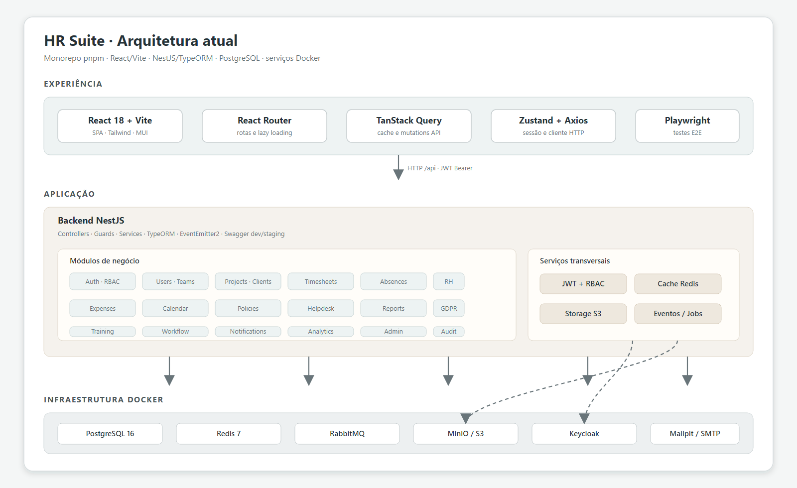
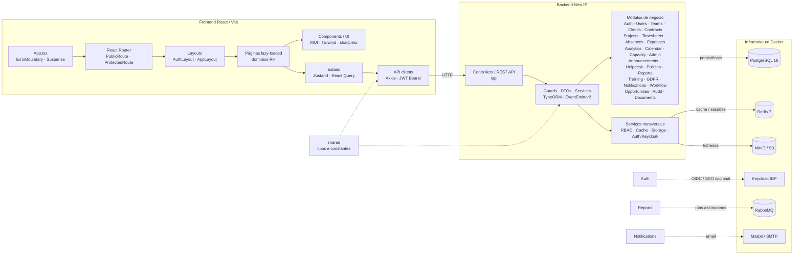
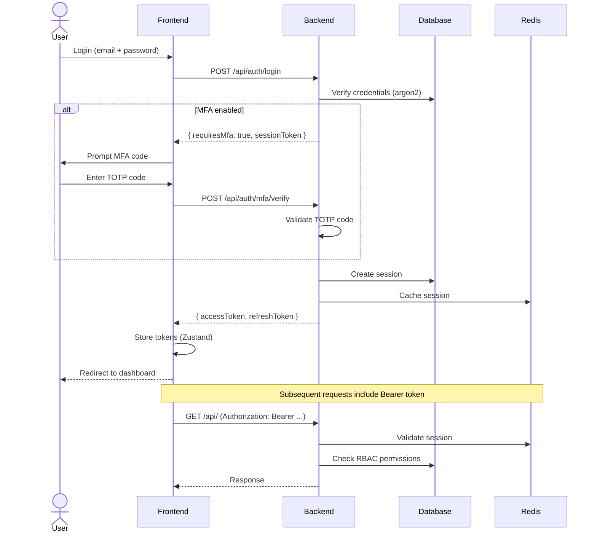
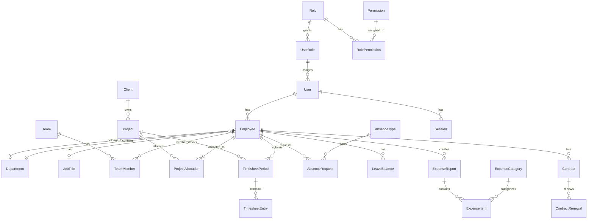

# Architecture

## Current Architecture

O diagrama acima representa o estado atual do sistema: frontend React/Vite, API NestJS,
módulos de negócio, serviços transversais e infraestrutura Docker. O SVG é vetorial e pode
ser reutilizado em documentação técnica, apresentações e exportações para PDF.

## Current Component Diagram

O frontend está documentado em detalhe no diagrama [frontend-architecture.png](./frontend-architecture.png).
O Keycloak é uma integração opcional para SSO; o login por email/password usa diretamente o módulo
de autenticação do backend. Redis é usado por cache e sessões, RabbitMQ por relatórios assíncronos,
MinIO por armazenamento S3 e Mailpit/SMTP por notificações de email.

## Auth Sequence

## Simplified ER Diagram

## ADRs (Architecture Decision Records)

| ID      | Decisão                                            | Contexto                                                    | Consequências                                           |
| ------- | -------------------------------------------------- | ----------------------------------------------------------- | ------------------------------------------------------- |
| ADR-001 | Monorepo com pnpm workspaces                       | Partilha de tipos entre backend e frontend                  | Dependências centralizadas, `@bridge351/srh-shared`     |
| ADR-002 | NestJS + TypeORM + PostgreSQL                      | Framework maduro, decorators, integração nativa com TypeORM | Módulos bem estruturados, migrations automáticas        |
| ADR-003 | React 18 + Vite + Tailwind                         | Performance, DX, ecossistema moderno                        | Build rápido (~8s), bundle otimizado                    |
| ADR-004 | JWT + Redis para sessões                           | Stateless por padrão, revogação via Redis                   | `accessToken` 15min, `refreshToken` 7d com rotação      |
| ADR-005 | Keycloak para SSO corporativo                      | Suporte a OIDC, SAML, federacao de identidade               | Opcional — login direto funciona sem Keycloak           |
| ADR-006 | RBAC com 4 roles (admin/manager/approver/employee) | Hierarquia simples, 30 permissoes base                      | Fácil de auditar, extensível via tabela `permissions`   |
| ADR-007 | MinIO para armazenamento de documentos             | Compatível com S3, auto-hospedado                           | Presigned URLs para upload/download seguro              |
| ADR-008 | RabbitMQ para relatorios assincronos               | Processamento em background de relatorios grandes           | Retorno 202 Accepted, polling de status                 |
| ADR-009 | Redis para cache (TTL 5min)                        | Analytics e dashboards com dados agregados                  | Cache decorator `@CacheResult`, invalidação manual      |
| ADR-010 | Notificacoes por polling (60s)                     | Simplicidade vs WebSocket/SSE                               | Endpoint `GET /notifications`, badge na sidebar         |
| ADR-011 | Swagger apenas em dev/staging                      | Seguranca — nao expor docs em producao                      | Condicional `NODE_ENV === 'development' \|\| 'staging'` |
| ADR-012 | Layout fixo para dashboard v1                      | Sem widgets arrastaveis                                     | Menos complexidade, sem persistencia de layout          |
| ADR-013 | Playwright headless sempre                         | Consistencia entre ambientes                                | `headless: true` na config, CI e local                  |
| ADR-014 | Portugues PT como lingua unica v1                  | Sem biblioteca i18n nesta fase                              | Todo o UI em PT, sem suporte multi-idioma               |
| ADR-015 | Testes e2e com `--runInBand` e `dropSchema`        | Base de dados limpa por execucao                            | Testes isolados, sequenciais, sem interferencia         |

---

_HR Suite — Bridge351 © 2026_
