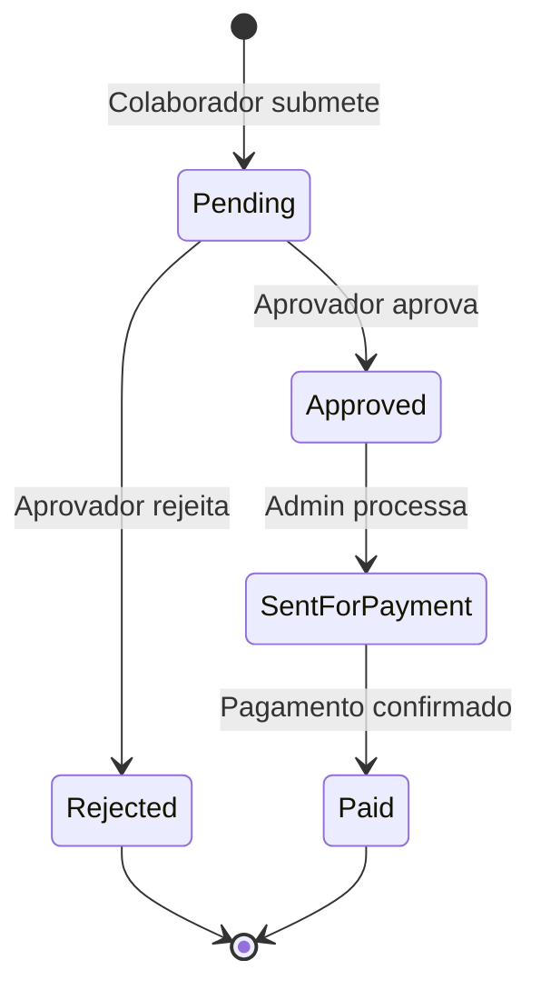

# Módulo 09 — Despesas & Reembolsos

## Objetivo

Gerir o ciclo de vida de despesas profissionais submetidas por colaboradores, desde a submissão até ao pagamento, com suporte a categorias específicas, aprovação e exportação.

---

## Entidades

### ExpenseReport (Relatório de Despesas)

| Campo        | Tipo          | Validação                                           | Notas |
| ------------ | ------------- | --------------------------------------------------- | ----- |
| id           | UUID          | PK                                                  | —     |
| employee_id  | UUID          | FK → Employee                                       | —     |
| title        | VARCHAR(200)  | Obrigatório                                         | —     |
| period_start | DATE          | Obrigatório                                         | —     |
| period_end   | DATE          | Obrigatório                                         | —     |
| status       | ENUM          | pending, approved, sent_for_payment, paid, rejected | —     |
| total_amount | DECIMAL(12,2) | Calculado                                           | —     |
| currency     | VARCHAR(3)    | Default EUR                                         | —     |
| project_id   | UUID          | FK → Project, Nullable                              | —     |
| notes        | TEXT          | Nullable                                            | —     |
| submitted_at | TIMESTAMP     | —                                                   |
| approved_at  | TIMESTAMP     | —                                                   |
| approved_by  | UUID          | FK → Employee                                       | —     |
| paid_at      | TIMESTAMP     | —                                                   |

### ExpenseLine (Linha de Despesa)

| Campo           | Tipo          | Validação                                           | Notas                  |
| --------------- | ------------- | --------------------------------------------------- | ---------------------- |
| id              | UUID          | PK                                                  | —                      |
| report_id       | UUID          | FK → ExpenseReport                                  | —                      |
| category        | ENUM          | mileage, public_transport, fuel, allowance, regular | —                      |
| description     | VARCHAR(200)  | Obrigatório                                         | —                      |
| amount          | DECIMAL(10,2) | > 0, Obrigatório                                    | —                      |
| currency        | VARCHAR(3)    | Default EUR                                         | —                      |
| expense_date    | DATE          | Obrigatório                                         | —                      |
| receipt_url     | VARCHAR(512)  | Nullable                                            | —                      |
| project_id      | UUID          | FK → Project, Nullable                              | Pode diferir do report |
| is_duplicate    | BOOLEAN       | Default false                                       | Detecção automática    |
| vehicle_plate   | VARCHAR(20)   | Nullable                                            | Para quilometragem     |
| distance_km     | DECIMAL(8,2)  | Nullable                                            | Para quilometragem     |
| mileage_map_url | VARCHAR(512)  | Nullable                                            | Mapa de quilometragem  |

---

## Regras de Negócio

| ID         | Regra                                                                                                    |
| ---------- | -------------------------------------------------------------------------------------------------------- |
| BR-EXP-001 | Despesas de quilometragem requerem matrícula da viatura e mapa de percurso.                              |
| BR-EXP-002 | O sistema deve detetar automaticamente despesas duplicadas (mesmo valor, data e categoria no mesmo mês). |
| BR-EXP-003 | Um relatório de despesas aprovado não pode ser editado.                                                  |
| BR-EXP-004 | Despesas pendentes de aprovação não podem ser eliminadas pelo colaborador.                               |
| BR-EXP-005 | O estado "Enviado para pagamento" só pode ser definido pelo Administrador/RH após aprovação.             |
| BR-EXP-006 | Exportação em Excel/CSV disponível para todos os estados.                                                |

---

## Estados de Despesa

---

## Categorias de Despesa

| Categoria          | Campos Especiais    | Comprovativo |
| ------------------ | ------------------- | ------------ |
| Quilometragem      | Matrícula, Km, Mapa | Obrigatório  |
| Transporte público | —                   | Opcional     |
| Combustível        | —                   | Obrigatório  |
| Ajuda de custo     | —                   | Opcional     |
| Despesas regulares | —                   | Obrigatório  |

---

## Requisitos Funcionais

| ID         | Descrição                                                                                          |
| ---------- | -------------------------------------------------------------------------------------------------- |
| RF-EXP-001 | O sistema deve permitir submissão de despesas por colaboradores com upload de comprovativo.        |
| RF-EXP-002 | O sistema deve suportar agrupamento de despesas em relatório.                                      |
| RF-EXP-003 | O sistema deve detetar automaticamente despesas duplicadas.                                        |
| RF-EXP-004 | O sistema deve suportar aprovação e rejeição de despesas.                                          |
| RF-EXP-005 | O sistema deve permitir exportação em Excel e CSV.                                                 |
| RF-EXP-006 | O sistema deve gerir integração com cartões corporativos (importação futura).                      |
| RF-EXP-007 | O sistema deve associar despesas a projetos.                                                       |
| RF-EXP-008 | O sistema deve suportar campos específicos por categoria (matrícula, km, mapa para quilometragem). |

---

## Permissões

| Ação                     | Administrador |   Gestor    | Aprovador |  Colaborador  |
| ------------------------ | :-----------: | :---------: | :-------: | :-----------: |
| Submeter despesa própria |      ✅       |     ✅      |    ✅     |      ✅       |
| Aprovar despesa          |      ✅       | ✅ (equipa) |    ✅     |      ❌       |
| Marcar como pago         |      ✅       |     ❌      |    ❌     |      ❌       |
| Exportar despesas        |      ✅       |     ✅      |    ❌     | ✅ (próprias) |
| Ver todas as despesas    |      ✅       | ✅ (equipa) |    ❌     |      ❌       |

---

## APIs

### GET /api/v1/expense-reports

### POST /api/v1/expense-reports

### GET /api/v1/expense-reports/:id

### POST /api/v1/expense-reports/:id/lines

### PUT /api/v1/expense-reports/:id/lines/:line_id

### POST /api/v1/expense-reports/:id/approve

### POST /api/v1/expense-reports/:id/reject

### POST /api/v1/expense-reports/:id/send-for-payment

### POST /api/v1/expense-reports/:id/mark-paid

### GET /api/v1/expense-reports/export (CSV/Excel)

---

## Notas de Implementação (P-013 backend, P-045 fix de auto-serviço)

Prefixo de rota real é `/api/expenses/...`, sem `/v1` (consistente com o resto do backend). Rotas reais: `GET/POST /expenses`, `GET /expenses/:id`, `POST /expenses/:id/items`, `POST /expenses/:id/submit`, `POST /expenses/:id/approve`, `POST /expenses/:id/reject`, `POST /expenses/:id/send-for-payment`, `POST /expenses/:id/mark-paid`, `GET /expenses/export`, `GET/POST /expenses/categories`.

- **Fluxo de pagamento implementado em P-065** (o estado `sent_for_payment`/`paid` e o campo `paid_at` estavam na spec desde o início mas nunca tinham sido construídos — descoberto ao investigar como ligar o evento de auditoria `Paid`, ver `specs/AUDIT.md` e `specs/GLOBAL-TASKS-RISKS.md`, `R-044`): `ExpenseReportStatus` ganhou `SENT_FOR_PAYMENT`/`PAID` (a par de `DRAFT`, que já era uma extensão sobre a lista original da spec); novo campo `paidAt` (`ExpenseReport.paidAt`, `timestamp NULL`, migração `1831000000000-AddPaidAtToExpenseReports.ts`). `ExpensesService.sendForPayment()` (`APPROVED` → `SENT_FOR_PAYMENT`) e `ExpensesService.markPaid()` (`SENT_FOR_PAYMENT` → `PAID`, define `paidAt`) seguem exatamente o diagrama de estados linear da spec, sem atalho direto de `APPROVED` para `PAID` (decisão P065-01, escolhida pelo utilizador entre o fluxo completo de 2 passos e uma versão simplificada de 1 passo). Ambos os endpoints restritos a `RoleEnum.ADMIN` via `@Roles()` (BR-EXP-005 + tabela de permissões — nem Gestor nem Aprovador podem marcar como pago), mesmo padrão de guarda já usado noutros endpoints admin-only do backend, sem verificação adicional ao nível do serviço. Eventos `expense.sent_for_payment`/`expense.paid` emitidos (mesmo padrão de `expense.submitted`/`approved`/`rejected`), sem consumidores novos (nenhuma notificação associada nesta fase — fora do âmbito, que era ligar o evento de auditoria). Só `mark-paid` está decorado com `@Audit('Paid', 'ExpenseReport')` — `send-for-payment` não está na lista mínima de eventos da spec de auditoria (`specs/AUDIT.md`), por isso fica sem decorador, consistente com o padrão já estabelecido em P-063.

- **Bug corrigido em P-045 (`R-038`)**: `ExpensesController` passava `req.user.sub` (JWT, `User.id`) diretamente onde `ExpensesService` esperava um `Employee.id` — em `findAll`/`export` (filtro por auto-serviço), `create` (`employeeId` do novo relatório), `findOne`/`addItem`/`submit` (comparação de dono) e `approve`/`reject` (`approverId`, verificado por `ExpensesService.validateApprover()`). Só funcionava para o admin (`Employee.id = User.id` por convenção do seed de P-035); qualquer colaborador ou gestor real recebia "Colaborador não encontrado" ao criar um relatório ou "Aprovador não encontrado" ao aprovar. Corrigido injetando o novo `EmployeeIdentityService` partilhado (`backend/src/auth/services/employee-identity.service.ts`) em `ExpensesController`, resolvendo sempre `Employee.id` a partir do `userId` do JWT antes de usar. Verificado em runtime com um colaborador (Bruno Costa) e gestor (Ana Silva) reais: criação, adição de item e aprovação bem-sucedidas.
- **Gap descoberto em P-045, corrigido em P-046 (`R-039`)**: `ExpensesService.validateApprover()` tinha um bypass de admin quebrado — `if (approver.userId === 'admin') return;` comparava uma coluna UUID com a string literal `'admin'`, nunca verdadeiro. Na prática, ADMIN só conseguia aprovar/rejeitar despesas de colaboradores dos quais fosse `managerId` direto. Corrigido substituindo pela verificação real via novo `RbacService.isAdmin(userId)` (`if (await this.rbacService.isAdmin(approver.userId)) return;`). O mesmo padrão foi corrigido em `AbsencesService`/`TimesheetsService`.
- **P-053**: `ExpensesService.createReport()`/`addItem()` passam a usar `SystemSetting.defaultCurrency` como fallback quando o DTO não indica `currency` (antes hardcoded `'EUR'`); o `default: 'EUR'` ao nível da coluna em `ExpenseReport`/`ExpenseItem` mantém-se inalterado (nunca exercitado na prática, regra 4). Ver `specs/ADMIN.md` ("Wiring de Admin Settings ao runtime — Grupo B") para o detalhe completo.

### P-085 — Relatórios em rascunho sem forma de editar/submeter (`R-055`)

Bug reportado diretamente pelo utilizador ao usar a instância de demo: "Na guia de despesas, tenho relatórios com o estado de RASCUNHO. Entretanto, não consigo editá-los e nem submetê-los." Investigação confirmou um bug estrutural em `frontend/src/pages/ExpenseNewPage.tsx`: os botões "Guardar Rascunho" e "Submeter para Aprovação" faziam exatamente a mesma coisa — só chamavam `createExpenseReport()` (cria o relatório vazio). Os itens preenchidos no formulário nunca eram persistidos (`addExpenseItem()` nunca era chamado) e "Submeter para Aprovação" nunca chamava `submitExpenseReport()`. Além disso, **não existia nenhuma página em todo o frontend para editar/submeter um relatório já criado** (a `ExpenseDetailPage.tsx` de P-084 só tinha Aprovar/Rejeitar, para quem revê).

Apresentadas 2 opções ao utilizador — **escolhida a Opção B (completa)**: (1) `ExpenseNewPage.tsx` corrigido para persistir cada item via `POST /expenses/:id/items` depois de criar o relatório, e para chamar `POST /expenses/:id/submit` quando "Submeter para Aprovação" é clicado (só depois de os itens serem adicionados); navega para `/expenses/:id` no fim, em vez de voltar à lista, para o utilizador confirmar imediatamente o resultado. (2) `ExpenseDetailPage.tsx` ganhou uma secção "Adicionar Item" (categoria/descrição/valor/data — sem campo de recibo, ver nota abaixo) e um botão "Submeter para Aprovação", visíveis só quando `status === draft` **e** o utilizador autenticado é o dono do relatório. Como o frontend não tem acesso ao `Employee.id` do utilizador (só `User.id`/email, mesmo problema estrutural do histórico `R-038`), a deteção de dono usa `user.email === report.employee.email` — funciona porque `GET /expenses/:id` já só deixa ver relatórios alheios a `ADMIN`/`MANAGER`/`APPROVER`, e o pior cenário de um falso positivo é um botão que o backend rejeita com 403 (sem risco de segurança, só imprecisão de UI).

**Limitação conhecida, não resolvida nesta sessão**: `BadRequestException` de `ExpensesService.submit()` para categorias com `requiresReceipt: true` sem `receiptUrl` — não existe **nenhum mecanismo de upload de recibo** ligado a Despesas em todo o projeto (o campo de ficheiro em `ExpenseNewPage.tsx` já era, e continua a ser, decorativo — nunca fez upload para lado nenhum). Um relatório com pelo menos um item de categoria "exige recibo" (5 das 8 categorias seed) nunca poderá ser submetido enquanto isto não for construído — candidato a uma sessão futura maior (decisão de arquitetura: reaproveitar o módulo Documents/MinIO já existente, ou um mecanismo dedicado).

**Bug adjacente encontrado e corrigido en passant**: `ExpensesService.approve()`/`reject()`/`submit()` só carregam a relação `items` (nem sempre) — nenhum carrega `employee`, pelo que a resposta destas 3 ações nunca inclui o nome do colaborador. Em vez de alterar o backend (que teria de ser replicado em 3 métodos + `AbsencesService` tem o mesmo padrão), corrigido no frontend: `ExpenseDetailPage.tsx`/`AbsenceDetailPage.tsx` deixam de confiar na resposta parcial da mutation (`setQueryData`) e passam a invalidar+refazer o pedido (`invalidateQueries`), que usa sempre `GET /expenses/:id`/`GET /absences/:id` (com todas as relações). **`TimesheetDetailPage.tsx` tem exatamente o mesmo padrão** (`TimesheetsService.approve()`/`reject()` também não carregam `employee`) — não corrigido nesta sessão, fora do âmbito (ficheiro de sessões anteriores, não tocado), candidato a correção futura se se tornar visível.

`pnpm run lint` (0 erros) e `pnpm run build` (raiz, backend, frontend) green. Só frontend alterado, nenhuma migração nem endpoint novo. **Verificação em ambiente real completa** (Playwright headless, dados reais de demo): o relatório em rascunho "Transportes" de `mariana.ferreira` usado como caso real — item de categoria "Alimentação" (exige recibo) adicionado com sucesso, submissão corretamente rejeitada com a mensagem real do backend ("A categoria Alimentação exige comprovativo..."); item de categoria "Transporte" (não exige recibo) adicionado e submetido com sucesso, relatório passou a `pending`, nome "Mariana Ferreira" confirmado a aparecer corretamente mesmo após a submissão (prova do fix da relação em falta) e após reload da página. Todos os dados de teste revertidos ao estado original (itens de teste eliminados, relatório reposto a `draft`/`totalAmount: 0`/`submittedAt: NULL` via `psql`) no fecho da sessão. `specs/GLOBAL-TASKS-RISKS.md` (`R-055`) documenta o detalhe.

---

## Eventos do Sistema

| Evento                     | Trigger              |
| -------------------------- | -------------------- |
| `ExpenseSubmitted`         | Colaborador submete  |
| `ExpenseApproved`          | Aprovação            |
| `ExpenseRejected`          | Rejeição             |
| `DuplicateExpenseDetected` | Duplicado detectado  |
| `ExpensePaid`              | Pagamento confirmado |

---

## Questões em Aberto

| ID        | Questão                                                                                                                                                                                                                                                                                                                                                                                                                              | Prioridade |
| --------- | ------------------------------------------------------------------------------------------------------------------------------------------------------------------------------------------------------------------------------------------------------------------------------------------------------------------------------------------------------------------------------------------------------------------------------------ | ---------- |
| Q-EXP-001 | Qual o valor por km para quilometragem? É configurável por empresa?                                                                                                                                                                                                                                                                                                                                                                  | Alta       |
| Q-EXP-002 | Existe limite máximo por despesa ou por relatório mensal?                                                                                                                                                                                                                                                                                                                                                                            | Média      |
| Q-EXP-003 | A integração com cartões corporativos é na v1 ou futura?                                                                                                                                                                                                                                                                                                                                                                             | Alta       |
| Q-EXP-004 | Existe multi-moeda (EUR + outra)?                                                                                                                                                                                                                                                                                                                                                                                                    | Média      |
| Q-EXP-005 | **Descoberto em P-085**: 5 das 8 categorias seed exigem `receiptUrl` para submissão (BR do backend, `ExpensesService.submit()`), mas não existe nenhum mecanismo de upload de recibo ligado a Despesas em todo o projeto — reaproveitar o módulo Documents/MinIO já existente (upload real, ligado a `ExpenseItem`) ou construir um mecanismo dedicado? Sem isto, nenhum relatório com um item dessas categorias pode ser submetido. | Alta       |
