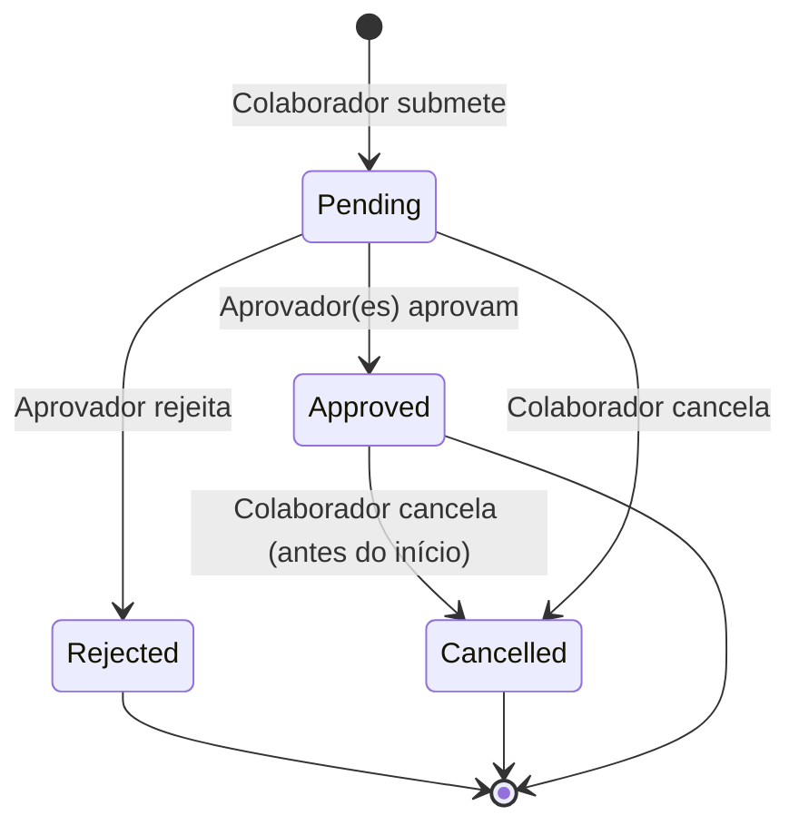

# Módulo 08 — Gestão Avançada de Ausências

## Objetivo

Gerir pedidos de ausência, férias e licenças com políticas configuráveis, fluxos de aprovação multi-etapa e controlo automático de saldos.

---

## Responsabilidades

1. Gerir tipos de ausência configuráveis.
2. Controlar saldo de férias por colaborador.
3. Suportar fluxos de aprovação multi-etapa.
4. Exigir documentos justificativos para tipos específicos.
5. Integrar com calendário organizacional.
6. Configurar períodos bloqueados para pedidos.

---

## Entidades

### AbsenceType (Tipo de Ausência)

| Campo             | Tipo         | Validação          | Notas                            |
| ----------------- | ------------ | ------------------ | -------------------------------- |
| id                | UUID         | PK                 | —                                |
| name              | VARCHAR(100) | Único, Obrigatório | —                                |
| code              | VARCHAR(20)  | Único              | —                                |
| unit              | ENUM         | days, hours        | —                                |
| limit_per_year    | DECIMAL(6,2) | Nullable           | Null = sem limite                |
| requires_document | BOOLEAN      | Default false      | —                                |
| is_paid           | BOOLEAN      | Default true       | —                                |
| affects_balance   | BOOLEAN      | Default true       | Conta para saldo férias          |
| color             | VARCHAR(7)   | Hex color          | Para calendário                  |
| is_system         | BOOLEAN      | Default false      | Tipos do sistema não elimináveis |
| is_active         | BOOLEAN      | Default true       | —                                |
| allowed_roles     | JSONB        | Nullable           | Quem pode usar este tipo         |
| blocked_periods   | JSONB        | Nullable           | Períodos onde não se pode pedir  |

### AbsenceRequest (Pedido de Ausência)

| Campo            | Tipo         | Validação                              | Notas              |
| ---------------- | ------------ | -------------------------------------- | ------------------ |
| id               | UUID         | PK                                     | —                  |
| employee_id      | UUID         | FK → Employee                          | —                  |
| absence_type_id  | UUID         | FK → AbsenceType                       | —                  |
| start_date       | DATE         | Obrigatório                            | —                  |
| end_date         | DATE         | Obrigatório, ≥ start_date              | —                  |
| start_half       | BOOLEAN      | Default false                          | Início em meio-dia |
| end_half         | BOOLEAN      | Default false                          | Fim em meio-dia    |
| total_days       | DECIMAL(5,2) | Calculado                              | —                  |
| total_hours      | DECIMAL(6,2) | Calculado                              | —                  |
| status           | ENUM         | pending, approved, rejected, cancelled | —                  |
| reason           | TEXT         | Nullable                               | —                  |
| rejection_reason | TEXT         | Nullable                               | —                  |
| document_url     | VARCHAR(512) | Nullable                               | Comprovativo       |
| created_at       | TIMESTAMP    | Auto                                   | —                  |
| updated_at       | TIMESTAMP    | Auto                                   | —                  |

### AbsenceApprovalStep (Etapa de Aprovação)

| Campo       | Tipo      | Notas                       |
| ----------- | --------- | --------------------------- |
| id          | UUID      | PK                          |
| request_id  | UUID      | FK → AbsenceRequest         |
| step_order  | INT       | Ordem da etapa              |
| approver_id | UUID      | FK → Employee               |
| status      | ENUM      | pending, approved, rejected |
| decision_at | TIMESTAMP | —                           |
| comments    | TEXT      | —                           |

### LeaveBalance (Saldo de Férias)

| Campo           | Tipo         | Notas                       |
| --------------- | ------------ | --------------------------- |
| id              | UUID         | PK                          |
| employee_id     | UUID         | FK → Employee               |
| absence_type_id | UUID         | FK → AbsenceType            |
| year            | INT          | —                           |
| entitled_days   | DECIMAL(5,2) | Dias com direito            |
| used_days       | DECIMAL(5,2) | Dias utilizados             |
| pending_days    | DECIMAL(5,2) | Pedidos pendentes           |
| remaining_days  | DECIMAL(5,2) | Calculado                   |
| carry_over_days | DECIMAL(5,2) | Transitados do ano anterior |

---

## Tipos de Ausência Sistema (Pré-definidos)

| Código       | Nome                  | Documento Obrigatório | Pago                |
| ------------ | --------------------- | --------------------- | ------------------- |
| VACATION     | Férias                | Não                   | Sim                 |
| SICK         | Baixa médica          | Sim                   | Sim                 |
| BEREAVEMENT  | Falecimento           | Sim                   | Sim                 |
| LEAVE        | Licença               | Sim                   | Conforme tipo       |
| TRAINING     | Formação              | Não                   | Sim                 |
| GIFT_DAY     | Dia oferecido         | Não                   | Sim                 |
| FAMILY       | Assistência à família | Não                   | Conforme legislação |
| MARRIAGE     | Casamento             | Sim                   | Sim                 |
| MEDICAL_APPT | Consulta médica       | Sim                   | Sim                 |
| OTHER        | Outras (configurável) | Configurável          | Configurável        |

---

## Casos de Uso

### UC-ABS-001 — Solicitar Ausência

**Objetivo:** Colaborador submete pedido de ausência.  
**Pré-condições:** Colaborador ativo; tipo de ausência ativo.  
**Fluxo Principal:**

1. Colaborador acede a "Pedir Ausência".
2. Seleciona tipo, datas e adiciona motivo (opcional).
3. Se tipo requer documento, sistema exige upload.
4. Sistema calcula dias úteis no período.
5. Sistema verifica saldo disponível.
6. Sistema verifica períodos bloqueados.
7. Sistema cria pedido com status `pending`.
8. Sistema cria etapas de aprovação.
9. Sistema notifica aprovadores.
10. Emite `AbsenceRequested`.

**Fluxos Alternativos:**

- 5a. Saldo insuficiente → aviso; colaborador pode continuar (exceto se regra bloquear).
- 6a. Período bloqueado → impedir submissão; informar colaborador.
- 3a. Documento não enviado para tipo obrigatório → erro de validação.

---

### UC-ABS-002 — Aprovar/Rejeitar Ausência

**Objetivo:** Aprovador decide sobre pedido de ausência.  
**Pré-condições:** Pedido em `pending`; aprovador da etapa atual.  
**Fluxo Principal:**

1. Aprovador recebe notificação.
2. Aprovador acede ao pedido na caixa de entrada.
3. Aprovador revê detalhes, saldo e calendário da equipa.
4. Aprovador aprova ou rejeita com comentário.
5. Se aprovação multi-etapa e há próxima etapa → notificar próximo aprovador.
6. Se última etapa aprovada → status = `approved`; saldo é debitado.
7. Colaborador é notificado.
8. Emite `AbsenceApproved` ou `AbsenceRejected`.

---

### UC-ABS-003 — Cancelar Ausência

**Objetivo:** Colaborador cancela pedido antes ou durante período.  
**Pré-condições:** Pedido em `pending` ou `approved` (antes do início).  
**Fluxo Principal:**

1. Colaborador cancela pedido.
2. Se `approved` → saldo é restituído.
3. Aprovadores são notificados.
4. Emite `AbsenceCancelled`.

---

### UC-ABS-004 — Gerir Saldo de Férias

**Objetivo:** Controlar e ajustar saldos anuais.  
**Pré-condições:** Admin autenticado.  
**Fluxo Principal:**

1. Admin acede a "Saldos de Férias".
2. Sistema apresenta saldo por colaborador e tipo.
3. Admin pode ajustar manualmente (com motivo e auditoria).
4. No início do ano, sistema cria novos saldos e aplica transitados.

---

## Regras de Negócio

| ID         | Regra                                                                                                |
| ---------- | ---------------------------------------------------------------------------------------------------- |
| BR-ABS-001 | Baixa médica, Falecimento, Licença, Casamento e Consulta exigem documento justificativo obrigatório. |
| BR-ABS-002 | Não é possível submeter pedido de ausência em período bloqueado pela empresa.                        |
| BR-ABS-003 | O saldo de férias é debitado apenas após aprovação final.                                            |
| BR-ABS-004 | Pedidos de ausência sobrepostos com ausência já aprovada não são permitidos.                         |
| BR-ABS-005 | Fins de semana e feriados não contam para o total de dias de ausência.                               |
| BR-ABS-006 | O cancelamento de ausência aprovada só é possível antes do início do período.                        |
| BR-ABS-007 | Dias de férias não gozados podem ser transitados para o ano seguinte (configurável por empresa).     |
| BR-ABS-008 | Para aprovação multi-etapa, cada etapa deve ser aprovada pela ordem definida.                        |
| BR-ABS-009 | Um colaborador inativo não pode submeter novos pedidos de ausência.                                  |

---

## Requisitos Funcionais

| ID         | Descrição                                                                     |
| ---------- | ----------------------------------------------------------------------------- |
| RF-ABS-001 | O sistema deve suportar tipos de ausência configuráveis com limites e regras. |
| RF-ABS-002 | O sistema deve controlar automaticamente saldo de férias por colaborador.     |
| RF-ABS-003 | O sistema deve suportar fluxos de aprovação multi-etapa configuráveis.        |
| RF-ABS-004 | O sistema deve exigir documento justificativo para tipos específicos.         |
| RF-ABS-005 | O sistema deve calcular dias úteis excluindo feriados e fins de semana.       |
| RF-ABS-006 | O sistema deve permitir configurar períodos bloqueados para pedidos.          |
| RF-ABS-007 | O sistema deve integrar ausências aprovadas no calendário organizacional.     |
| RF-ABS-008 | O sistema deve integrar ausências aprovadas na folha de horas.                |
| RF-ABS-009 | O sistema deve permitir consulta de histórico de ausências por colaborador.   |
| RF-ABS-010 | O sistema deve suportar pedido de meio-dia de ausência.                       |

---

## Diagrama de Estados do Pedido de Ausência



---

## Permissões

| Ação                           | Administrador | Gestor | Aprovador | Colaborador |
| ------------------------------ | :-----------: | :----: | :-------: | :---------: |
| Submeter própria ausência      |      ✅       |   ✅   |    ✅     |     ✅      |
| Aprovar ausência da equipa     |      ✅       |   ✅   |    ✅     |     ❌      |
| Rejeitar ausência              |      ✅       |   ✅   |    ✅     |     ❌      |
| Ver ausências da equipa        |      ✅       |   ✅   |    ✅     |     ❌      |
| Ver próprias ausências         |      ✅       |   ✅   |    ✅     |     ✅      |
| Gerir tipos de ausência        |      ✅       |   ❌   |    ❌     |     ❌      |
| Ajustar saldos manualmente     |      ✅       |   ❌   |    ❌     |     ❌      |
| Configurar períodos bloqueados |      ✅       |   ❌   |    ❌     |     ❌      |

---

## Eventos do Sistema

| Evento                | Trigger                    |
| --------------------- | -------------------------- |
| `AbsenceRequested`    | Pedido submetido           |
| `AbsenceApproved`     | Aprovação final            |
| `AbsenceRejected`     | Rejeição                   |
| `AbsenceCancelled`    | Cancelamento               |
| `LeaveBalanceUpdated` | Alteração de saldo         |
| `LeaveBalanceAlert`   | Saldo baixo (configurável) |

---

## APIs

### GET /api/v1/absence-requests

- **Query:** `employee_id`, `status`, `type`, `start_date`, `end_date`

### POST /api/v1/absence-requests

### GET /api/v1/absence-requests/:id

### POST /api/v1/absence-requests/:id/approve

### POST /api/v1/absence-requests/:id/reject

- **Entrada:** `{ reason }`

### POST /api/v1/absence-requests/:id/cancel

### GET /api/v1/absence-types

### POST /api/v1/absence-types

### GET /api/v1/leave-balances

- **Query:** `employee_id`, `year`

### PUT /api/v1/leave-balances/:id (admin only)

---

## Critérios de Aceitação (Gherkin)

```gherkin
Feature: Pedido de Ausência

  Scenario: Submeter pedido de férias com saldo suficiente
    Given um colaborador com 15 dias de férias disponíveis
    When o colaborador submete pedido de 5 dias de férias
    Then o pedido fica com status "pending"
    And 5 dias ficam em "pending_days" no saldo
    And o aprovador é notificado

  Scenario: Documento obrigatório em baixa médica
    Given um colaborador a submeter pedido de "Baixa médica"
    When o colaborador tenta submeter sem anexar documento
    Then o sistema retorna erro de validação
    And o pedido NÃO é criado

  Scenario: Impedir ausência em período bloqueado
    Given a empresa definiu Dezembro como período bloqueado para férias
    When um colaborador tenta pedir férias em Dezembro
    Then o sistema rejeita o pedido
    And informa o colaborador do período bloqueado

  Scenario: Saldo restituído após cancelamento
    Given um pedido de férias aprovado com 3 dias
    And o período ainda não começou
    When o colaborador cancela o pedido
    Then os 3 dias são restituídos ao saldo
    And o pedido fica com status "cancelled"
```

---

## Notas de Implementação (P-012)

**Bug corrigido em P-045 (`R-038`)**: `AbsencesController` passava `req.user.sub` (JWT, `User.id`) diretamente onde se esperava `Employee.id` — em `findAll` (filtro de auto-serviço), `create` (`employeeId` do novo pedido), `findOne`/`uploadDocument` (comparação de dono), `approve`/`reject` (`approverId`, verificado por `AbsencesService.validateApprover()`), `cancel` e `getBalance`. Só funcionava para o admin; um colaborador ou gestor real recebia sempre 403 ao aceder aos seus próprios pedidos, ou nunca conseguia criar um pedido (FK inválida). Corrigido injetando o novo `EmployeeIdentityService` partilhado (`backend/src/auth/services/employee-identity.service.ts`), que resolve `Employee.id` a partir do `userId` do JWT. Verificado em runtime: Bruno Costa (colaborador) criou/listou/cancelou um pedido próprio, Ana Silva (gestora) aprovou-o.

**Gap descoberto em P-045, corrigido em P-046 (`R-039`)**: `AbsencesService.validateApprover()` tinha um bypass de admin quebrado (`approver.userId === 'admin'`, comparação de UUID contra string literal, nunca verdadeiro) — na prática ADMIN só conseguia aprovar/rejeitar pedidos de colaboradores dos quais fosse `managerId` direto. Corrigido substituindo pela verificação real via novo `RbacService.isAdmin(userId)`. O mesmo padrão foi corrigido em `TimesheetsService`/`ExpensesService`. Verificado em runtime: ADMIN aprovou um pedido de Bruno Costa sem ser o seu gestor direto.

**Gap pré-existente desde a implementação original do módulo, corrigido em P-057 (wiring de `defaultVacationDaysPerYear`/`carryOverVacationDays` do Admin Settings)**: nenhuma linha `LeaveBalance` era criada em lado nenhum (nem seed, nem endpoint, nem cron) — `AbsencesService.create()` só faz `if (balance) { ... }` antes de validar saldo, pelo que sem nenhuma linha a validação era sempre um no-op silencioso e qualquer pedido de férias, de qualquer tamanho, era sempre aceite. Corrigido com um novo `AbsencesService.generateAnnualLeaveBalances()` (`@Cron('0 7 1 1 *')`, 1 de janeiro, mesmo padrão do cron anual de feriados de `CalendarService`), que cria a linha `LeaveBalance` do tipo `VACATION` para cada colaborador ativo sem uma já existente para o ano corrente. `entitledDays` vem de `settings.defaultVacationDaysPerYear`, proporcional aos meses restantes do ano para colaboradores admitidos durante esse mesmo ano (`computeEntitledVacationDays()`, arredondado por mês, sem granularidade ao dia); colaboradores admitidos em anos anteriores recebem o valor completo. `carryOverDays` vem de `min(settings.carryOverVacationDays, remainingDays do ano anterior)` (`computeCarryOverDays()`), zero se não existir uma linha do ano anterior. Detalhe completo (incluindo as 3 decisões de produto tomadas antes de implementar) em `specs/admin/SPEC.md`.

**Gap descoberto e corrigido em P-061 (`R-045`)**: `AbsencesService.approve()` emite o evento `absence.approved`, mas nenhum consumidor sincronizava a ausência aprovada com a folha de horas do colaborador — `TimesheetsService.syncAbsences()` existia mas nunca era chamado. Corrigido com um novo consumidor, `TimesheetsService.handleAbsenceApproved()`. Detalhe completo em `specs/timesheets/SPEC.md` e `specs/GLOBAL-TASKS-RISKS.md` (`R-045`).

### Entregue nesta fase

- **Entidades implementadas:** `AbsenceType`, `AbsenceRequest`, `AbsenceApproval`, `LeaveBalance`.
  - A entidade `AbsenceApprovalStep` da spec inicial foi simplificada para `AbsenceApproval` com decisão única.
- **Endpoints implementados** (sob o prefixo `/api/absences`):
  - `GET /api/absences`
  - `POST /api/absences`
  - `GET /api/absences/:id`
  - `POST /api/absences/:id/approve`
  - `POST /api/absences/:id/reject`
  - `POST /api/absences/:id/cancel`
  - `POST /api/absences/:id/document`
  - `GET /api/absences/balance/:employeeId`
  - `GET /api/absences/calendar`
- **Regras implementadas:** BR-ABS-001 a BR-ABS-006 e BR-ABS-009.
- ~~Cálculo de dias úteis exclui fins de semana e feriados via `HolidayCalendar`.~~ **Corrigido em P-071**: `HolidayCalendar` (`hr.holiday_calendars`) era uma tabela órfã, sem seed/import/CRUD, sempre vazia — feriados nunca eram de facto excluídos. `calculateBusinessDays()` passa a consultar `CalendarService.findHolidays()` (`hr.public_holidays`, a tabela real, populada via `POST /calendar/holidays/import`), resolvendo o país pela `LegalEntity` do colaborador (`AdminService.getEffectiveCountryCode(employeeId)`, novo parâmetro opcional do método). Ver `specs/admin/SPEC.md` ("Ligar Calendar à entidade legal") e `specs/GLOBAL-TASKS-RISKS.md` para o detalhe completo.
- Saldo é debitado na aprovação e restituído no cancelamento antes da data de início.
- Seed de tipo de ausência (`VACATION`) via `AbsenceType`.

### Simplificações / Decisões

- `allowed_roles` e `blocked_periods` são persistidos como `text` simples (JSON) nesta fase; `allowed_roles` ainda não é aplicado nas validações.
- A aprovação multi-etapa (RF-ABS-003) não foi implementada; a aprovação é única pelo manager direto ou admin.
- Os endpoints não usam o prefixo `/api/v1/absence-requests` previsto na spec inicial, mas sim `/api/absences`.
- `LeaveBalanceAlert` e o ajuste manual de saldos (UC-ABS-004) ainda não foram implementados.
- ~~**Gap conhecido, documentado como `R-043`, não corrigido em P-057**: `generateAnnualLeaveBalances()` só corre uma vez por ano (1 de janeiro); um colaborador admitido depois dessa data fica sem nenhuma linha `LeaveBalance` para esse ano — de volta ao comportamento de no-op silencioso — até ao cron do ano seguinte.~~ **Corrigido em P-070** (decisão P070-02, escolhida pelo utilizador entre 2 opções — fallback lazy completo incl. carry-over vs. só entitlement): a lógica de criação de saldo do cron foi extraída para `createVacationBalanceForEmployee()` (reutilizada por `generateAnnualLeaveBalances()` e por um novo `ensureVacationBalance(employeeId, year)`); `AbsencesService.create()` passa a chamar `ensureVacationBalance()` quando não encontra um saldo `VACATION` para o ano corrente, antes de validar o pedido — cria o saldo na hora, com o mesmo pro-rating e carry-over já usados pelo cron, em vez de esperar pelo cron do ano seguinte. Ver `specs/admin/SPEC.md`/`specs/GLOBAL-TASKS-RISKS.md` (`R-043` resolvido) para o detalhe completo.

### Testes

- 25 testes unitários em `src/absences/services/absences.service.spec.ts`, mais 4 novos em P-057 para `generateAnnualLeaveBalances()`.
- 15 testes e2e em `test/absences.e2e-spec.ts`.

---

## Questões em Aberto

| ID        | Questão                                                                                                                                                                                                                                                               | Prioridade |
| --------- | --------------------------------------------------------------------------------------------------------------------------------------------------------------------------------------------------------------------------------------------------------------------- | ---------- |
| Q-ABS-001 | ~~Quantos dias de férias tem direito cada colaborador por ano (22 dias por lei portuguesa)? É configurável?~~ **Resolvido em P-057**: configurável via `SystemSetting.defaultVacationDaysPerYear` (default 22), ligado ao runtime em `generateAnnualLeaveBalances()`. | ~~Alta~~   |
| Q-ABS-002 | Os dias de férias transitados do ano anterior têm prazo de validade? (nota P-057: `carryOverDays` fica somado a `remainingDays` sem expiração própria à parte — os dias transitados usam-se como qualquer outro dia do ano, sem prazo adicional)                      | Alta       |
| Q-ABS-003 | A aprovação multi-etapa é configurável por tipo de ausência ou global?                                                                                                                                                                                                | Alta       |
| Q-ABS-004 | Quem é o aprovador por defeito quando não há gestor definido?                                                                                                                                                                                                         | Alta       |
| Q-ABS-005 | Existe limite máximo de dias de ausência consecutivos sem aprovação especial?                                                                                                                                                                                         | Média      |
