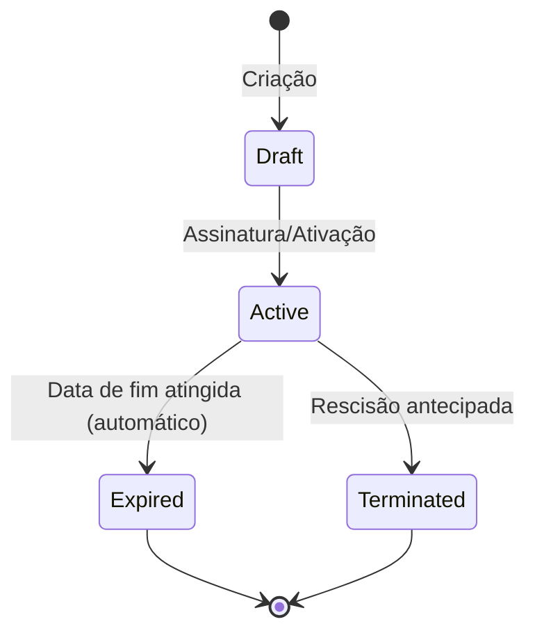

# Módulo 11 — Gestão de Contratos

## Objetivo

Gerir o ciclo de vida contratual dos colaboradores e prestadores, com alertas de renovação/expiração, associação documental e histórico completo.

## Entidades

### Contract

| Campo              | Tipo          | Validação                              | Notas                                           |
| ------------------ | ------------- | -------------------------------------- | ----------------------------------------------- |
| id                 | UUID          | PK                                     | —                                               |
| employee_id        | UUID          | FK Employee                            | —                                               |
| contract_type      | ENUM          | permanent, fixed_term, freelancer, b2b | —                                               |
| status             | ENUM          | draft, active, expired, terminated     | —                                               |
| start_date         | DATE          | Obrigatório                            | —                                               |
| end_date           | DATE          | Nullable                               | Null para sem termo                             |
| value              | DECIMAL(12,2) | Nullable                               | Sensível GDPR                                   |
| currency           | VARCHAR(3)    | Default EUR                            | —                                               |
| contracting_entity | VARCHAR(200)  | Obrigatório                            | —                                               |
| legal_entity_id    | UUID          | FK LegalEntity, Nullable               | Adicionado em P-069, ver Notas de Implementação |
| renewal_alert_days | INT           | Default 30                             | —                                               |
| document_url       | VARCHAR(512)  | Nullable                               | —                                               |
| notes              | TEXT          | Nullable                               | —                                               |
| created_at         | TIMESTAMP     | Auto                                   | —                                               |
| terminated_at      | TIMESTAMP     | Nullable                               | —                                               |
| termination_reason | TEXT          | Nullable                               | —                                               |

## Regras de Negócio

| ID         | Regra                                                                                |
| ---------- | ------------------------------------------------------------------------------------ |
| BR-CON-001 | Um colaborador não pode ter dois contratos ativos em simultâneo.                     |
| BR-CON-002 | Contratos sem termo (permanent) não têm data de fim.                                 |
| BR-CON-003 | Alertas de renovação gerados N dias antes do end_date (N configurável por contrato). |
| BR-CON-004 | A rescisão de contrato deve registar motivo e data.                                  |
| BR-CON-005 | O valor do contrato é dado sensível (GDPR) — visível apenas a Administradores.       |

## Estados do Contrato

## Requisitos Funcionais

| ID         | Descrição                                                              |
| ---------- | ---------------------------------------------------------------------- |
| RF-CON-001 | O sistema deve suportar tipos: Sem termo, A termo, Freelancer, B2B.    |
| RF-CON-002 | O sistema deve gerar alertas de renovação e expiração configuráveis.   |
| RF-CON-003 | O sistema deve manter histórico contratual completo.                   |
| RF-CON-004 | O sistema deve associar documentos ao contrato.                        |
| RF-CON-005 | O sistema deve impedir dois contratos ativos para o mesmo colaborador. |

## Permissões

| Ação                             | Administrador | Gestor | Aprovador | Colaborador |
| -------------------------------- | :-----------: | :----: | :-------: | :---------: |
| Criar/editar contrato            |      ✅       |   ❌   |    ❌     |     ❌      |
| Ver valor do contrato            |      ✅       |   ❌   |    ❌     |     ❌      |
| Ver próprio contrato (sem valor) |      ✅       |   ✅   |    ✅     |     ✅      |
| Rescindir contrato               |      ✅       |   ❌   |    ❌     |     ❌      |

## Eventos do Sistema

| Evento                 | Trigger              |
| ---------------------- | -------------------- |
| `ContractCreated`      | Criação              |
| `ContractActivated`    | Ativação             |
| `ContractExpired`      | Expiração automática |
| `ContractTerminated`   | Rescisão             |
| `ContractRenewalAlert` | N dias antes do fim  |

## APIs

- GET /api/v1/contracts
- POST /api/v1/contracts
- GET /api/v1/contracts/:id
- PUT /api/v1/contracts/:id
- POST /api/v1/contracts/:id/terminate
- GET /api/v1/employees/:id/contracts

## Notas de Implementação

### Entregue

- **Entidades:** `Contract` (TypeORM) com os campos definidos na spec, incluindo `terminatedAt` e `terminationReason`; entidade `ContractRenewal` para histórico de renovações.
- **DTOs:** `CreateContractDto`, `UpdateContractDto`, `RenewContractDto`.
- **Service:** `ContractsService` com métodos `create`, `findAll`, `findOne`, `update`, `renew`, `terminate` (P-067), `findExpiringSoon`, `scheduleExpirationAlerts`, `getDocumentPresignedUrl`.
- **Controller:** `ContractsController` expõe os endpoints:
  - `GET /contracts` (com filtros opcionais `status` e `employeeId`)
  - `GET /contracts/:id`
  - `POST /contracts`
  - `PATCH /contracts/:id`
  - `POST /contracts/:id/renew`
  - `POST /contracts/:id/terminate` (P-067)
  - `GET /contracts/:id/document`
- **Eventos:** `ContractExpiringSoonEvent` emitido via `EventEmitter2` no tópico `contract.expiring-soon`.
- **Cron jobs:** `scheduleExpirationAlerts` executa diariamente às 08:00 — emite eventos para contratos que expiram em até 30 dias e marca contratos com `endDate` ultrapassado como `expired`.
- **Tipos de contrato:** `permanent`, `fixed_term`, `freelancer`, `b2b`.
- **Estados do contrato:** `draft`, `active`, `expired`, `terminated`.
- **Renovações:** implementadas através do endpoint `POST /contracts/:id/renew`, que cria registo em `ContractRenewal` e atualiza `endDate` do contrato.

### Simplificações/Decisões

- **`POST /contracts/:id/terminate` implementado em P-067** (descoberto ao investigar como ligar o evento de auditoria `Contracts: Terminated`, `R-044` — ver `specs/audit/SPEC.md` e `specs/GLOBAL-TASKS-RISKS.md`): `ContractsService.terminate(id, dto)` valida que o contrato está `ACTIVE` (mesmo padrão de validação de `renew()`), define `status: TERMINATED`, `terminatedAt: now()` e `terminationReason: dto.reason` (`TerminateContractDto`, campo `reason` obrigatório, alinhado com BR-CON-004). Endpoint restrito a `RoleEnum.ADMIN` (tabela de permissões: "Rescindir contrato" só Administrador). Ao contrário de `renew()`, decorado com `@Audit('Terminated', 'Contract')`. Consistente com `create()`/`renew()` (nenhum dos dois emite os eventos `ContractCreated`/`ContractActivated` listados na tabela "Eventos do Sistema"), `terminate()` também não emite `ContractTerminated` via `EventEmitter2` — decisão deliberada de manter o padrão já existente no módulo, não uma omissão.
- **`legal_entity_id` adicionado em P-069** (ao ligar `LegalEntity` ao runtime — ver `specs/admin/SPEC.md`, secção "Ligar LegalEntity ao runtime", e `specs/GLOBAL-TASKS-RISKS.md`): novo FK opcional para `hr.legal_entities`, adicionado **a par** de `contracting_entity` (texto livre, decisão P069-03) — não o substitui, sem migração de dados existentes. `CreateContractDto`/`UpdateContractDto` ganham `legalEntityId` opcional, passa através do `dto` genérico já usado por `create()`/`update()` (sem alteração ao service). Quando definido no contrato `ACTIVE` de um colaborador, `AdminService.getEffectiveLegalEntity(employeeId)` resolve a `LegalEntity` correspondente e os seus campos passam a ter efeito real em `ExpensesService` (moeda) e `AbsencesService` (dias de férias) — ver `specs/admin/SPEC.md` para o detalhe completo do override.
- Não existe endpoint `GET /employees/:id/contracts`.
- A criação de contrato valida que o colaborador não tem outro contrato `active`, mas não valida transição de estados (p.ex. `draft` → `active`).
- O campo `value` é guardado em claro; não existe mascaramento GDPR nem controlo de permissão específico para o seu acesso.
- O endpoint `GET /contracts/:id/document` devolve diretamente o `documentUrl`; não gera presigned URL.
- O cron usa sempre 30 dias para alertas, ignorando o valor configurado em `renewalAlertDays` do contrato.
- Apenas Administradores podem criar/editar/renovar; Gestores podem apenas visualizar.
- Não existem listeners registados para o evento `contract.expiring-soon`.

### Testes

- `backend/src/contracts/services/contracts.service.spec.ts` cobre `create`, `findOne`, `renew`, `terminate` (P-067), `findExpiringSoon`, `scheduleExpirationAlerts`, `getDocumentPresignedUrl`. Não existem testes unitários para o controller nem testes E2E para o módulo.

## Questões em Aberto

| ID        | Questão                                                            | Prioridade |
| --------- | ------------------------------------------------------------------ | ---------- |
| Q-CON-001 | A assinatura digital é na v1 ou fase futura?                       | Alta       |
| Q-CON-002 | Freelancers e B2B têm campos específicos adicionais (NIF empresa)? | Alta       |
| Q-CON-003 | Existe fluxo de aprovação para criação de contratos?               | Média      |
