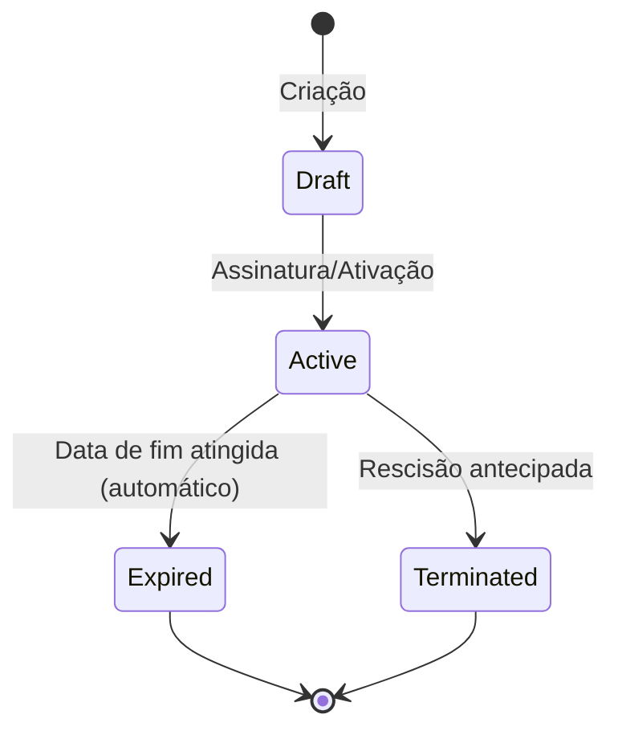

# Módulo 11 — Gestão de Contratos

## Objetivo
Gerir o ciclo de vida contratual dos colaboradores e prestadores, com alertas de renovação/expiração, associação documental e histórico completo.

## Entidades

### Contract
| Campo | Tipo | Validação | Notas |
|-------|------|-----------|-------|
| id | UUID | PK | — |
| employee_id | UUID | FK Employee | — |
| contract_type | ENUM | permanent, fixed_term, freelancer, b2b | — |
| status | ENUM | draft, active, expired, terminated | — |
| start_date | DATE | Obrigatório | — |
| end_date | DATE | Nullable | Null para sem termo |
| value | DECIMAL(12,2) | Nullable | Sensível GDPR |
| currency | VARCHAR(3) | Default EUR | — |
| contracting_entity | VARCHAR(200) | Obrigatório | — |
| renewal_alert_days | INT | Default 30 | — |
| document_url | VARCHAR(512) | Nullable | — |
| notes | TEXT | Nullable | — |
| created_at | TIMESTAMP | Auto | — |
| terminated_at | TIMESTAMP | Nullable | — |
| termination_reason | TEXT | Nullable | — |

## Regras de Negócio

| ID | Regra |
|----|-------|
| BR-CON-001 | Um colaborador não pode ter dois contratos ativos em simultâneo. |
| BR-CON-002 | Contratos sem termo (permanent) não têm data de fim. |
| BR-CON-003 | Alertas de renovação gerados N dias antes do end_date (N configurável por contrato). |
| BR-CON-004 | A rescisão de contrato deve registar motivo e data. |
| BR-CON-005 | O valor do contrato é dado sensível (GDPR) — visível apenas a Administradores. |

## Estados do Contrato

## Requisitos Funcionais

| ID | Descrição |
|----|-----------|
| RF-CON-001 | O sistema deve suportar tipos: Sem termo, A termo, Freelancer, B2B. |
| RF-CON-002 | O sistema deve gerar alertas de renovação e expiração configuráveis. |
| RF-CON-003 | O sistema deve manter histórico contratual completo. |
| RF-CON-004 | O sistema deve associar documentos ao contrato. |
| RF-CON-005 | O sistema deve impedir dois contratos ativos para o mesmo colaborador. |

## Permissões

| Ação | Administrador | Gestor | Aprovador | Colaborador |
|------|:---:|:---:|:---:|:---:|
| Criar/editar contrato | ✅ | ❌ | ❌ | ❌ |
| Ver valor do contrato | ✅ | ❌ | ❌ | ❌ |
| Ver próprio contrato (sem valor) | ✅ | ✅ | ✅ | ✅ |
| Rescindir contrato | ✅ | ❌ | ❌ | ❌ |

## Eventos do Sistema

| Evento | Trigger |
|--------|---------|
| `ContractCreated` | Criação |
| `ContractActivated` | Ativação |
| `ContractExpired` | Expiração automática |
| `ContractTerminated` | Rescisão |
| `ContractRenewalAlert` | N dias antes do fim |

## APIs

- GET /api/v1/contracts
- POST /api/v1/contracts
- GET /api/v1/contracts/:id
- PUT /api/v1/contracts/:id
- POST /api/v1/contracts/:id/terminate
- GET /api/v1/employees/:id/contracts

## Questões em Aberto

| ID | Questão | Prioridade |
|----|---------|------------|
| Q-CON-001 | A assinatura digital é na v1 ou fase futura? | Alta |
| Q-CON-002 | Freelancers e B2B têm campos específicos adicionais (NIF empresa)? | Alta |
| Q-CON-003 | Existe fluxo de aprovação para criação de contratos? | Média |
