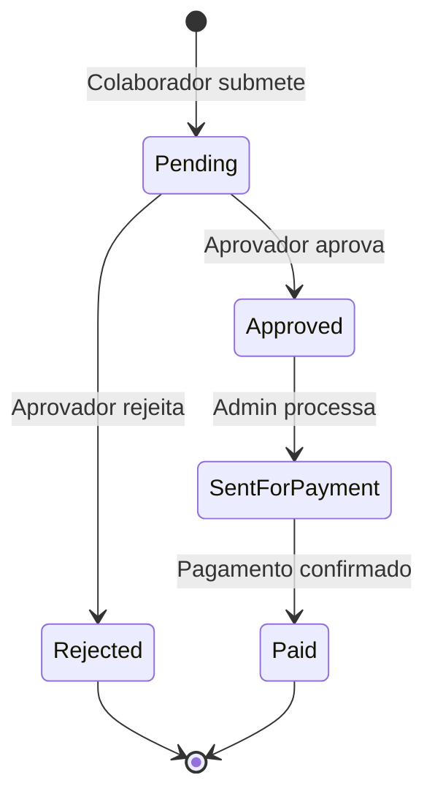

# Módulo 09 — Despesas & Reembolsos

## Objetivo

Gerir o ciclo de vida de despesas profissionais submetidas por colaboradores, desde a submissão até ao pagamento, com suporte a categorias específicas, aprovação e exportação.

---

## Entidades

### ExpenseReport (Relatório de Despesas)

| Campo        | Tipo          | Validação                                           | Notas |
| ------------ | ------------- | --------------------------------------------------- | ----- |
| id           | UUID          | PK                                                  | —     |
| employee_id  | UUID          | FK → Employee                                       | —     |
| title        | VARCHAR(200)  | Obrigatório                                         | —     |
| period_start | DATE          | Obrigatório                                         | —     |
| period_end   | DATE          | Obrigatório                                         | —     |
| status       | ENUM          | pending, approved, sent_for_payment, paid, rejected | —     |
| total_amount | DECIMAL(12,2) | Calculado                                           | —     |
| currency     | VARCHAR(3)    | Default EUR                                         | —     |
| project_id   | UUID          | FK → Project, Nullable                              | —     |
| notes        | TEXT          | Nullable                                            | —     |
| submitted_at | TIMESTAMP     | —                                                   |
| approved_at  | TIMESTAMP     | —                                                   |
| approved_by  | UUID          | FK → Employee                                       | —     |
| paid_at      | TIMESTAMP     | —                                                   |

### ExpenseLine (Linha de Despesa)

| Campo           | Tipo          | Validação                                           | Notas                  |
| --------------- | ------------- | --------------------------------------------------- | ---------------------- |
| id              | UUID          | PK                                                  | —                      |
| report_id       | UUID          | FK → ExpenseReport                                  | —                      |
| category        | ENUM          | mileage, public_transport, fuel, allowance, regular | —                      |
| description     | VARCHAR(200)  | Obrigatório                                         | —                      |
| amount          | DECIMAL(10,2) | > 0, Obrigatório                                    | —                      |
| currency        | VARCHAR(3)    | Default EUR                                         | —                      |
| expense_date    | DATE          | Obrigatório                                         | —                      |
| receipt_url     | VARCHAR(512)  | Nullable                                            | —                      |
| project_id      | UUID          | FK → Project, Nullable                              | Pode diferir do report |
| is_duplicate    | BOOLEAN       | Default false                                       | Detecção automática    |
| vehicle_plate   | VARCHAR(20)   | Nullable                                            | Para quilometragem     |
| distance_km     | DECIMAL(8,2)  | Nullable                                            | Para quilometragem     |
| mileage_map_url | VARCHAR(512)  | Nullable                                            | Mapa de quilometragem  |

---

## Regras de Negócio

| ID         | Regra                                                                                                    |
| ---------- | -------------------------------------------------------------------------------------------------------- |
| BR-EXP-001 | Despesas de quilometragem requerem matrícula da viatura e mapa de percurso.                              |
| BR-EXP-002 | O sistema deve detetar automaticamente despesas duplicadas (mesmo valor, data e categoria no mesmo mês). |
| BR-EXP-003 | Um relatório de despesas aprovado não pode ser editado.                                                  |
| BR-EXP-004 | Despesas pendentes de aprovação não podem ser eliminadas pelo colaborador.                               |
| BR-EXP-005 | O estado "Enviado para pagamento" só pode ser definido pelo Administrador/RH após aprovação.             |
| BR-EXP-006 | Exportação em Excel/CSV disponível para todos os estados.                                                |

---

## Estados de Despesa

---

## Categorias de Despesa

| Categoria          | Campos Especiais    | Comprovativo |
| ------------------ | ------------------- | ------------ |
| Quilometragem      | Matrícula, Km, Mapa | Obrigatório  |
| Transporte público | —                   | Opcional     |
| Combustível        | —                   | Obrigatório  |
| Ajuda de custo     | —                   | Opcional     |
| Despesas regulares | —                   | Obrigatório  |

---

## Requisitos Funcionais

| ID         | Descrição                                                                                          |
| ---------- | -------------------------------------------------------------------------------------------------- |
| RF-EXP-001 | O sistema deve permitir submissão de despesas por colaboradores com upload de comprovativo.        |
| RF-EXP-002 | O sistema deve suportar agrupamento de despesas em relatório.                                      |
| RF-EXP-003 | O sistema deve detetar automaticamente despesas duplicadas.                                        |
| RF-EXP-004 | O sistema deve suportar aprovação e rejeição de despesas.                                          |
| RF-EXP-005 | O sistema deve permitir exportação em Excel e CSV.                                                 |
| RF-EXP-006 | O sistema deve gerir integração com cartões corporativos (importação futura).                      |
| RF-EXP-007 | O sistema deve associar despesas a projetos.                                                       |
| RF-EXP-008 | O sistema deve suportar campos específicos por categoria (matrícula, km, mapa para quilometragem). |

---

## Permissões

| Ação                     | Administrador |   Gestor    | Aprovador |  Colaborador  |
| ------------------------ | :-----------: | :---------: | :-------: | :-----------: |
| Submeter despesa própria |      ✅       |     ✅      |    ✅     |      ✅       |
| Aprovar despesa          |      ✅       | ✅ (equipa) |    ✅     |      ❌       |
| Marcar como pago         |      ✅       |     ❌      |    ❌     |      ❌       |
| Exportar despesas        |      ✅       |     ✅      |    ❌     | ✅ (próprias) |
| Ver todas as despesas    |      ✅       | ✅ (equipa) |    ❌     |      ❌       |

---

## APIs

### GET /api/v1/expense-reports

### POST /api/v1/expense-reports

### GET /api/v1/expense-reports/:id

### POST /api/v1/expense-reports/:id/lines

### PUT /api/v1/expense-reports/:id/lines/:line_id

### POST /api/v1/expense-reports/:id/approve

### POST /api/v1/expense-reports/:id/reject

### POST /api/v1/expense-reports/:id/send-for-payment

### POST /api/v1/expense-reports/:id/mark-paid

### GET /api/v1/expense-reports/export (CSV/Excel)

---

## Notas de Implementação (P-013 backend, P-045 fix de auto-serviço)

Prefixo de rota real é `/api/expenses/...`, sem `/v1` (consistente com o resto do backend). Rotas reais: `GET/POST /expenses`, `GET /expenses/:id`, `POST /expenses/:id/items`, `POST /expenses/:id/submit`, `POST /expenses/:id/approve`, `POST /expenses/:id/reject`, `GET /expenses/export`, `GET/POST /expenses/categories`.

- **Bug corrigido em P-045 (`R-038`)**: `ExpensesController` passava `req.user.sub` (JWT, `User.id`) diretamente onde `ExpensesService` esperava um `Employee.id` — em `findAll`/`export` (filtro por auto-serviço), `create` (`employeeId` do novo relatório), `findOne`/`addItem`/`submit` (comparação de dono) e `approve`/`reject` (`approverId`, verificado por `ExpensesService.validateApprover()`). Só funcionava para o admin (`Employee.id = User.id` por convenção do seed de P-035); qualquer colaborador ou gestor real recebia "Colaborador não encontrado" ao criar um relatório ou "Aprovador não encontrado" ao aprovar. Corrigido injetando o novo `EmployeeIdentityService` partilhado (`backend/src/auth/services/employee-identity.service.ts`) em `ExpensesController`, resolvendo sempre `Employee.id` a partir do `userId` do JWT antes de usar. Verificado em runtime com um colaborador (Bruno Costa) e gestor (Ana Silva) reais: criação, adição de item e aprovação bem-sucedidas.
- **Gap descoberto em P-045, corrigido em P-046 (`R-039`)**: `ExpensesService.validateApprover()` tinha um bypass de admin quebrado — `if (approver.userId === 'admin') return;` comparava uma coluna UUID com a string literal `'admin'`, nunca verdadeiro. Na prática, ADMIN só conseguia aprovar/rejeitar despesas de colaboradores dos quais fosse `managerId` direto. Corrigido substituindo pela verificação real via novo `RbacService.isAdmin(userId)` (`if (await this.rbacService.isAdmin(approver.userId)) return;`). O mesmo padrão foi corrigido em `AbsencesService`/`TimesheetsService`.
- **P-053**: `ExpensesService.createReport()`/`addItem()` passam a usar `SystemSetting.defaultCurrency` como fallback quando o DTO não indica `currency` (antes hardcoded `'EUR'`); o `default: 'EUR'` ao nível da coluna em `ExpenseReport`/`ExpenseItem` mantém-se inalterado (nunca exercitado na prática, regra 4). Ver `specs/admin/SPEC.md` ("Wiring de Admin Settings ao runtime — Grupo B") para o detalhe completo.

---

## Eventos do Sistema

| Evento                     | Trigger              |
| -------------------------- | -------------------- |
| `ExpenseSubmitted`         | Colaborador submete  |
| `ExpenseApproved`          | Aprovação            |
| `ExpenseRejected`          | Rejeição             |
| `DuplicateExpenseDetected` | Duplicado detectado  |
| `ExpensePaid`              | Pagamento confirmado |

---

## Questões em Aberto

| ID        | Questão                                                             | Prioridade |
| --------- | ------------------------------------------------------------------- | ---------- |
| Q-EXP-001 | Qual o valor por km para quilometragem? É configurável por empresa? | Alta       |
| Q-EXP-002 | Existe limite máximo por despesa ou por relatório mensal?           | Média      |
| Q-EXP-003 | A integração com cartões corporativos é na v1 ou futura?            | Alta       |
| Q-EXP-004 | Existe multi-moeda (EUR + outra)?                                   | Média      |
