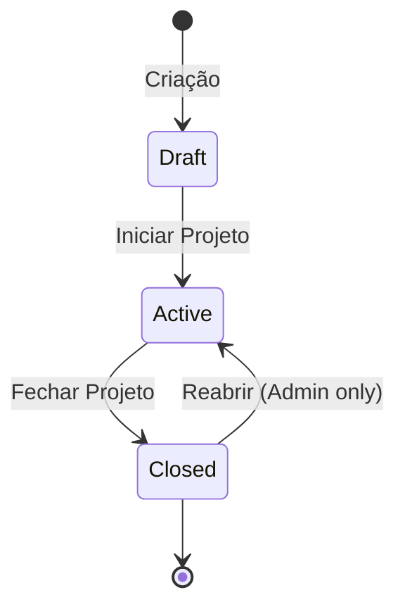

# Módulo 05 — Projetos

## Objetivo

Gerir o ciclo de vida completo de projetos, incluindo criação, alocação de recursos, estados, alertas e associação a clientes.

---

## Responsabilidades

1. Criar e gerir projetos com associação a clientes.
2. Definir e controlar estados do projeto (Draft, Active, Closed).
3. Alocar colaboradores e equipas a projetos com percentagem/horas.
4. Gerar alertas de fim de projeto e fim de alocação de consultores.
5. Associar faturas e documentação técnica.
6. Suportar planeamento de capacidade por projeto.

---

## Entidades

### Project

| Campo                 | Tipo          | Validação                  | Notas                        |
| --------------------- | ------------- | -------------------------- | ---------------------------- |
| id                    | UUID          | PK                         | —                            |
| name                  | VARCHAR(200)  | Obrigatório                | —                            |
| code                  | VARCHAR(50)   | Único, Nullable            | Código interno               |
| client_id             | UUID          | FK → Client, Obrigatório   | —                            |
| manager_id            | UUID          | FK → Employee, Obrigatório | Gestor responsável           |
| status                | ENUM          | draft, active, closed      | —                            |
| start_date            | DATE          | Obrigatório                | —                            |
| end_date              | DATE          | Nullable                   | —                            |
| description           | TEXT          | Nullable                   | —                            |
| hourly_rate           | DECIMAL(10,2) | Nullable                   | Taxa de faturação ao cliente |
| budget                | DECIMAL(15,2) | Nullable                   | Orçamento total              |
| alert_days_before_end | INT           | Default 30                 | Dias antes para alertar fim  |
| created_at            | TIMESTAMP     | Auto                       | —                            |
| updated_at            | TIMESTAMP     | Auto                       | —                            |

### ProjectAllocation (Alocação)

| Campo                 | Tipo          | Validação                        | Notas                            |
| --------------------- | ------------- | -------------------------------- | -------------------------------- |
| id                    | UUID          | PK                               | —                                |
| project_id            | UUID          | FK → Project                     | —                                |
| employee_id           | UUID          | FK → Employee                    | —                                |
| allocation_type       | ENUM          | percentage, hours                | —                                |
| allocation_value      | DECIMAL(5,2)  | 0–100 se percentage; >0 se hours | —                                |
| start_date            | DATE          | Obrigatório                      | —                                |
| end_date              | DATE          | Nullable                         | —                                |
| role_in_project       | VARCHAR(100)  | Nullable                         | ex: "Tech Lead"                  |
| hourly_rate_override  | DECIMAL(10,2) | Nullable                         | Substituir tarifário do cargo    |
| alert_days_before_end | INT           | Default 15                       | Alerta fim de alocação consultor |
| notes                 | TEXT          | Nullable                         | —                                |
| created_at            | TIMESTAMP     | Auto                             | —                                |

### ProjectTeamAllocation

| Campo                 | Tipo         | Notas        |
| --------------------- | ------------ | ------------ |
| project_id            | UUID         | FK → Project |
| team_id               | UUID         | FK → Team    |
| start_date            | DATE         | —            |
| end_date              | DATE         | —            |
| allocation_percentage | DECIMAL(5,2) | —            |

---

## Casos de Uso

### UC-PRJ-001 — Criar Projeto

**Objetivo:** Registar novo projeto no sistema.  
**Pré-condições:** Gestor ou Administrador autenticado; cliente existe.  
**Fluxo Principal:**

1. Gestor acede a "Novo Projeto".
2. Sistema apresenta formulário.
3. Gestor preenche: nome, cliente, datas, gestor responsável, estado inicial.
4. Sistema valida campos obrigatórios e datas (início ≤ fim).
5. Sistema cria projeto com status `draft`.
6. Emite `ProjectCreated`.

**Fluxos Alternativos:**

- 4a. Data de fim anterior a data de início → erro de validação.
- 4b. Cliente inativo → alertar; permitir continuar.

---

### UC-PRJ-002 — Alocar Colaborador a Projeto

**Objetivo:** Definir alocação de um colaborador num projeto.  
**Pré-condições:** Projeto em estado `active`; colaborador ativo.  
**Fluxo Principal:**

1. Gestor acede a "Alocações" do projeto.
2. Gestor seleciona colaborador, período, percentagem/horas e papel no projeto.
3. Sistema verifica se colaborador não está sobrealodado no período.
4. Sistema cria alocação.
5. Emite `EmployeeAllocated`.

**Fluxos Alternativos:**

- 3a. Sobrealodação detectada (total > 100%) → aviso; gestor decide se continua.
- 3b. Colaborador inativo → impedir alocação.

---

### UC-PRJ-003 — Alterar Estado do Projeto

**Objetivo:** Gerir o ciclo de vida do projeto.  
**Pré-condições:** Gestor ou Admin autenticado.  
**Transições de Estado:**

- `draft` → `active`: projeto iniciado oficialmente.
- `active` → `closed`: projeto encerrado.
- `closed` → `active`: reabertura (apenas Admin).

**Pós-condições:** Estado atualizado; `ProjectStatusChanged` emitido; notificações enviadas.

---

### UC-PRJ-004 — Definir Alertas de Fim de Projeto

**Objetivo:** Configurar alertas automáticos de expiração.  
**Fluxo Principal:**

1. Gestor define `alert_days_before_end` no projeto.
2. Gestor define `alert_days_before_end` em cada alocação.
3. Sistema processa diariamente e emite alertas quando atingido threshold.

---

## Regras de Negócio

| ID         | Regra                                                                                                                         |
| ---------- | ----------------------------------------------------------------------------------------------------------------------------- |
| BR-PRJ-001 | A data de fim do projeto deve ser posterior à data de início.                                                                 |
| BR-PRJ-002 | Um projeto no estado `closed` não aceita novas alocações.                                                                     |
| BR-PRJ-003 | A soma das percentagens de alocação de um colaborador num período não deve exceder 100%. Sobrealodação gera alerta, não erro. |
| BR-PRJ-004 | Um projeto `draft` não permite registo de horas.                                                                              |
| BR-PRJ-005 | Ao fechar um projeto, todas as alocações ativas são automaticamente encerradas.                                               |
| BR-PRJ-006 | O tarifário por hora do colaborador no projeto pode ser substituído pelo `hourly_rate_override` da alocação.                  |
| BR-PRJ-007 | Alertas de fim de projeto são enviados N dias antes, onde N é configurável por projeto.                                       |
| BR-PRJ-008 | Alertas de fim de alocação do consultor são enviados N dias antes do `end_date` da alocação.                                  |

---

## Requisitos Funcionais

| ID         | Descrição                                                                               |
| ---------- | --------------------------------------------------------------------------------------- |
| RF-PRJ-001 | O sistema deve permitir criar, editar e eliminar projetos.                              |
| RF-PRJ-002 | O sistema deve suportar os estados Draft, Active e Closed.                              |
| RF-PRJ-003 | O sistema deve permitir associar projetos a clientes.                                   |
| RF-PRJ-004 | O sistema deve permitir alocar colaboradores individuais e equipas a projetos.          |
| RF-PRJ-005 | O sistema deve detetar e alertar para sobrealodação de recursos.                        |
| RF-PRJ-006 | O sistema deve detetar e alertar para recursos sem alocação.                            |
| RF-PRJ-007 | O sistema deve gerar alertas configuráveis de fim de projeto.                           |
| RF-PRJ-008 | O sistema deve gerar alertas de fim de alocação por consultor.                          |
| RF-PRJ-009 | O sistema deve suportar upload de faturas e documentação associada ao projeto.          |
| RF-PRJ-010 | O sistema deve apresentar calendário visual de ocupação por projeto.                    |
| RF-PRJ-011 | O sistema deve permitir consultar histórico de alocações por projeto e por colaborador. |

---

## Permissões por Perfil

| Ação                    | Administrador |    Gestor     | Aprovador |  Colaborador  |
| ----------------------- | :-----------: | :-----------: | :-------: | :-----------: |
| Criar projeto           |      ✅       |      ✅       |    ❌     |      ❌       |
| Editar projeto          |      ✅       | ✅ (próprios) |    ❌     |      ❌       |
| Fechar/Reativar projeto |      ✅       | ✅ (próprios) |    ❌     |      ❌       |
| Alocar colaboradores    |      ✅       | ✅ (próprios) |    ❌     |      ❌       |
| Ver alocações           |      ✅       |      ✅       |    ✅     | ✅ (próprias) |
| Ver tarifários          |      ✅       |      ❌       |    ❌     |      ❌       |
| Upload de documentos    |      ✅       | ✅ (próprios) |    ❌     |      ❌       |

---

## Eventos do Sistema

| Evento                   | Trigger                         |
| ------------------------ | ------------------------------- |
| `ProjectCreated`         | Criação de projeto              |
| `ProjectUpdated`         | Alteração de dados              |
| `ProjectStatusChanged`   | Mudança de estado               |
| `EmployeeAllocated`      | Nova alocação criada            |
| `AllocationUpdated`      | Alteração de alocação           |
| `AllocationEnded`        | Fim de alocação                 |
| `ProjectEndingAlert`     | N dias antes do fim do projeto  |
| `AllocationEndingAlert`  | N dias antes do fim da alocação |
| `OverallocationDetected` | Sobrealodação detectada         |

---

## Diagrama de Estados do Projeto



---

## APIs

### GET /api/v1/projects

- **Query params:** `status`, `client_id`, `manager_id`, `search`, `page`, `limit`
- **HTTP:** 200, 401, 403

### POST /api/v1/projects

- **Entrada:** `{ name, client_id, manager_id, start_date, end_date, status, ... }`
- **HTTP:** 201, 422

### GET /api/v1/projects/:id

- **HTTP:** 200, 404

### PUT /api/v1/projects/:id

- **HTTP:** 200, 404, 422

### PATCH /api/v1/projects/:id/status

- **Entrada:** `{ status, reason? }`
- **HTTP:** 200, 409 (transição inválida)

### GET /api/v1/projects/:id/allocations

- **HTTP:** 200

### POST /api/v1/projects/:id/allocations

- **Entrada:** `{ employee_id, allocation_type, allocation_value, start_date, end_date, role_in_project }`
- **HTTP:** 201, 409 (sobrealodação), 422

### PUT /api/v1/projects/:id/allocations/:alloc_id

### DELETE /api/v1/projects/:id/allocations/:alloc_id

### GET /api/v1/projects/:id/capacity

- Retorna visão de capacidade por período
- **HTTP:** 200

---

## Critérios de Aceitação (Gherkin)

```gherkin
Feature: Gestão de Projetos

  Scenario: Criar projeto com dados válidos
    Given um gestor autenticado
    And o cliente "Acme Corp" existe no sistema
    When o gestor cria um projeto com nome "Portal Web", cliente "Acme Corp", início 2025-01-01
    Then o projeto é criado com estado "draft"
    And o evento "ProjectCreated" é emitido

  Scenario: Impedir alocação em projeto fechado
    Given um projeto com estado "closed"
    When um gestor tenta alocar um colaborador ao projeto
    Then o sistema retorna erro
    And a alocação NÃO é criada

  Scenario: Alerta de sobrealodação
    Given um colaborador com 80% de alocação no projeto A
    When um gestor tenta alocar o mesmo colaborador com 30% no projeto B no mesmo período
    Then o sistema emite um aviso de sobrealodação (total 110%)
    And permite que o gestor confirme ou cancele a alocação

  Scenario: Alerta de fim de projeto
    Given um projeto ativo com data de fim em 30 dias
    And o alerta configurado para 30 dias antes
    When o processo de alertas diário executa
    Then o sistema emite evento "ProjectEndingAlert"
    And o gestor do projeto recebe notificação
```

---

## Casos Limite

1. Projeto sem data de fim (projeto contínuo) — deve ser permitido.
2. Colaborador alocado a projeto que termina antes da sua alocação — alertar.
3. Projeto com gestor que foi entretanto desativado.
4. Alocação de equipa onde alguns membros estão sobrealodados.
5. Projeto com múltiplos gestores responsáveis — o documento assume um único; verificar.

---

## Notas de Implementação

### Entregue

- **Entidades:** `Project`, `ProjectAllocation` e `ProjectTeamAllocation` (esquema `hr`).
- **DTOs:** `CreateProjectDto`, `UpdateProjectDto`, `AllocateEmployeeDto` e `UpdateAllocationDto`.
- **Serviço:** `ProjectsService` — criação, listagem com filtros, consulta, atualização, ativação, encerramento e gestão de alocações.
- **Controlador:** `ProjectsController` com os seguintes endpoints (relativos ao prefixo da aplicação):
  - `GET /projects`, `POST /projects`, `GET /projects/:id`, `PATCH /projects/:id`
  - `POST /projects/:id/activate`, `POST /projects/:id/close`
  - `GET /projects/:id/allocations`, `POST /projects/:id/allocations`
  - `PATCH /projects/:id/allocations/:allocId`, `DELETE /projects/:id/allocations/:allocId`
- **Eventos:** `AllocationCreatedEvent`, `ProjectEndingAlertEvent`, `AllocationEndingAlertEvent`, `OverallocationDetectedEvent`.
- **Cron job:** `checkEndingProjects()` executa diariamente às 09:00 para emitir alertas de fim de projeto e fim de alocação.
- **Validações:**
  - Transições de estado `draft` → `active` (requer pelo menos uma alocação) e `active` → `closed`.
  - Impedida alocação em projetos `draft` ou `closed`.
  - Deteção de colaborador já ativo no mesmo projeto (alocação sem `end_date`).
  - Aviso de sobrealocação quando a soma de percentagens ativas ultrapassa 100%.

### Simplificações/Decisões

- Os eventos `ProjectCreated`, `ProjectUpdated`, `ProjectStatusChanged`, `AllocationUpdated` e `AllocationEnded` não estão implementados; emite-se `AllocationCreatedEvent` no lugar de `EmployeeAllocated`.
- A entidade `ProjectTeamAllocation` existe, mas não possui serviço, controlador nem endpoints nesta fase.
- As transições de estado não usam `PATCH /projects/:id/status`; usam os endpoints dedicados `POST /projects/:id/activate` e `POST /projects/:id/close`.
- A reabertura `closed` → `active` não está implementada.
- O upload de faturas/documentação, o calendário de capacidade (`GET /capacity`) e o histórico de alocações não estão implementados.
- A sobrealocação é um aviso não bloqueante (retornado no campo `warning`) e emite `OverallocationDetectedEvent`.
- A remoção de alocação é um _soft delete_: define `endDate` para a data atual em vez de apagar o registo.
- A verificação de sobreposição limita-se a alocações ativas (`endDate IS NULL`) no mesmo projeto; não valida interseção completa de intervalos de datas.
- O `UpdateProjectDto` aceita `status`, mas o campo é ignorado para transições de estado.

### Testes

- **Unitários:** `projects.service.spec.ts` cobre criação de alocações, erros para projeto `draft`/`closed`, colaborador inexistente, alocação ativa duplicada e aviso de sobrealocação.
- **e2e:** Não existem testes end-to-end dedicados ao módulo Projects.

## Questões em Aberto

| ID        | Questão                                                                                                                       | Prioridade |
| --------- | ----------------------------------------------------------------------------------------------------------------------------- | ---------- |
| Q-PRJ-001 | Um projeto pode ter múltiplos gestores responsáveis?                                                                          | Alta       |
| Q-PRJ-002 | Existe limite de colaboradores por projeto?                                                                                   | Baixa      |
| Q-PRJ-003 | As faturas associadas ao projeto são para controlo interno ou integração com ERP?                                             | Alta       |
| Q-PRJ-004 | A margem por consultor (rate do projeto vs custo do colaborador) como é calculada? Custo = salary/hora ou tarifário do cargo? | Alta       |
| Q-PRJ-005 | Projetos podem ter sub-projetos/fases?                                                                                        | Média      |
