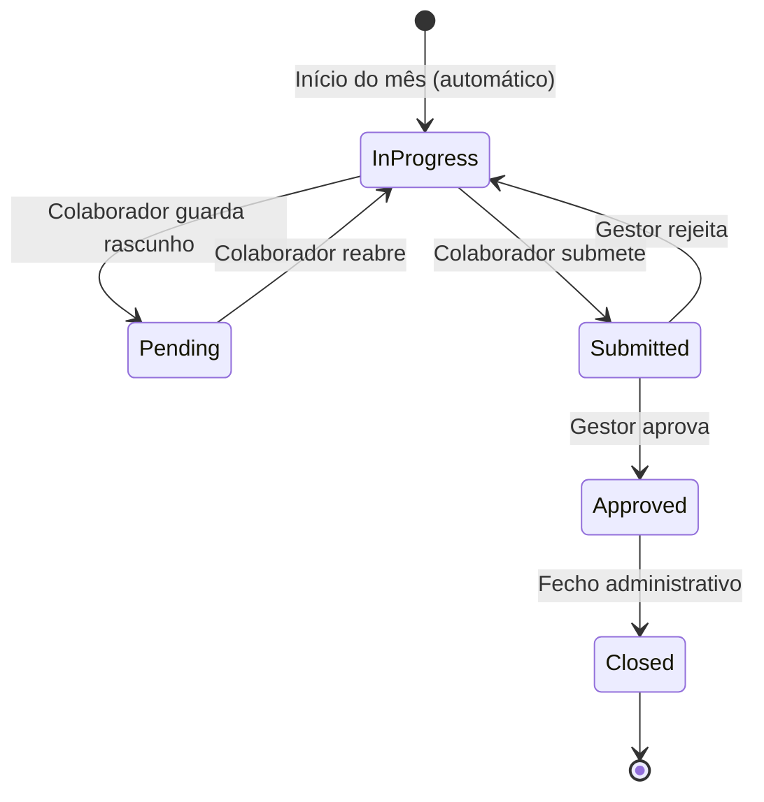

# Módulo 07 — Assiduidade & Timesheets

## Objetivo

Registar, validar e aprovar horas trabalhadas pelos colaboradores, com pré-preenchimento automático, associação a projetos, gestão de banco de horas e suporte a múltiplos tipos de horário.

---

## Responsabilidades

1. Pré-preencher automaticamente 8h por dia útil (excluindo feriados e fins de semana).
2. Permitir ajuste manual de horas pelo colaborador.
3. Associar horas registadas a projetos específicos.
4. Calcular horas extraordinárias e saldo de horas.
5. Suportar fluxo de submissão e aprovação mensal.
6. Bloquear edição após aprovação.
7. Gerir banco de horas.
8. Suportar turnos e horários flexíveis.

---

## Entidades

### Timesheet

| Campo                | Tipo         | Validação                                         | Notas            |
| -------------------- | ------------ | ------------------------------------------------- | ---------------- |
| id                   | UUID         | PK                                                | —                |
| employee_id          | UUID         | FK → Employee                                     | —                |
| period_year          | INT          | Obrigatório                                       | Ano              |
| period_month         | INT          | 1–12, Obrigatório                                 | Mês              |
| status               | ENUM         | in_progress, pending, submitted, approved, closed | —                |
| submitted_at         | TIMESTAMP    | Nullable                                          | —                |
| approved_at          | TIMESTAMP    | Nullable                                          | —                |
| approved_by          | UUID         | FK → Employee, Nullable                           | —                |
| total_planned_hours  | DECIMAL(6,2) | Calculado                                         | —                |
| total_worked_hours   | DECIMAL(6,2) | Calculado                                         | —                |
| total_overtime_hours | DECIMAL(6,2) | Calculado                                         | —                |
| hours_balance        | DECIMAL(6,2) | Calculado                                         | worked - planned |
| created_at           | TIMESTAMP    | Auto                                              | —                |
| updated_at           | TIMESTAMP    | Auto                                              | —                |

### TimesheetEntry (Linha da folha de horas)

| Campo          | Tipo         | Validação                       | Notas                    |
| -------------- | ------------ | ------------------------------- | ------------------------ |
| id             | UUID         | PK                              | —                        |
| timesheet_id   | UUID         | FK → Timesheet                  | —                        |
| entry_date     | DATE         | Obrigatório                     | —                        |
| project_id     | UUID         | FK → Project, Nullable          | —                        |
| absence_id     | UUID         | FK → AbsenceRequest, Nullable   | —                        |
| planned_hours  | DECIMAL(4,2) | 0–24, Default 8                 | —                        |
| worked_hours   | DECIMAL(4,2) | 0–24                            | —                        |
| overtime_hours | DECIMAL(4,2) | Calculado                       | —                        |
| entry_type     | ENUM         | work, absence, holiday, weekend | —                        |
| notes          | TEXT         | Nullable                        | —                        |
| is_locked      | BOOLEAN      | Default false                   | Bloqueado após aprovação |

### AttendanceRecord (Relógio de Ponto)

| Campo       | Tipo         | Validação               | Notas |
| ----------- | ------------ | ----------------------- | ----- |
| id          | UUID         | PK                      | —     |
| employee_id | UUID         | FK → Employee           | —     |
| record_date | DATE         | Obrigatório             | —     |
| check_in    | TIMESTAMP    | Nullable                | —     |
| check_out   | TIMESTAMP    | Nullable                | —     |
| break_start | TIMESTAMP    | Nullable                | —     |
| break_end   | TIMESTAMP    | Nullable                | —     |
| total_hours | DECIMAL(4,2) | Calculado               | —     |
| source      | ENUM         | manual, mobile, desktop | —     |
| created_at  | TIMESTAMP    | Auto                    | —     |

### WorkSchedule (Horário de Trabalho)

| Campo           | Tipo         | Validação              | Notas                  |
| --------------- | ------------ | ---------------------- | ---------------------- |
| id              | UUID         | PK                     | —                      |
| name            | VARCHAR(100) | Obrigatório            | ex: "Horário Standard" |
| type            | ENUM         | fixed, flexible, shift | —                      |
| monday_hours    | DECIMAL(4,2) | 0–24                   | —                      |
| tuesday_hours   | DECIMAL(4,2) | 0–24                   | —                      |
| wednesday_hours | DECIMAL(4,2) | 0–24                   | —                      |
| thursday_hours  | DECIMAL(4,2) | 0–24                   | —                      |
| friday_hours    | DECIMAL(4,2) | 0–24                   | —                      |
| saturday_hours  | DECIMAL(4,2) | Default 0              | —                      |
| sunday_hours    | DECIMAL(4,2) | Default 0              | —                      |
| is_night_shift  | BOOLEAN      | Default false          | —                      |
| is_active       | BOOLEAN      | Default true           | —                      |

### HolidayCalendar

| Campo        | Tipo         | Notas                       |
| ------------ | ------------ | --------------------------- |
| id           | UUID         | PK                          |
| country_code | VARCHAR(5)   | PT, ES, etc.                |
| holiday_date | DATE         | —                           |
| name         | VARCHAR(100) | Nome do feriado             |
| is_mandatory | BOOLEAN      | Feriado nacional vs local   |
| region       | VARCHAR(50)  | Nullable — feriado regional |

---

## Casos de Uso

### UC-TS-001 — Pré-Preencher Folha de Horas

**Objetivo:** Gerar automaticamente a folha do mês com 8h por dia útil.  
**Pré-condições:** Colaborador ativo com horário de trabalho definido.  
**Fluxo Principal:**

1. Sistema cria automaticamente Timesheet para cada colaborador no início do mês.
2. Para cada dia do mês, sistema verifica: fim de semana, feriado nacional, ausência aprovada.
3. Sistema preenche `planned_hours` de acordo com horário do colaborador.
4. Dias úteis sem ausências → 8h (ou horas do horário definido).
5. Fins de semana e feriados → 0h, `entry_type = weekend/holiday`.
6. Ausências aprovadas → horas da ausência, `entry_type = absence`.

---

### UC-TS-002 — Colaborador Regista Horas

**Objetivo:** Colaborador ajusta horas trabalhadas na folha.  
**Pré-condições:** Timesheet em estado `in_progress`; colaborador ativo.  
**Fluxo Principal:**

1. Colaborador acede à folha do mês corrente.
2. Colaborador edita horas para cada dia e associa projeto.
3. Sistema valida: horas entre 0–24; projeto ativo.
4. Sistema recalcula totais e horas extraordinárias.
5. Alterações são guardadas em tempo real.

**Regras:**

- Dias com `is_locked = true` não podem ser editados.
- Horas acima de 8h/dia são marcadas como extraordinárias.

---

### UC-TS-003 — Submeter Folha de Horas

**Objetivo:** Colaborador submete folha para aprovação.  
**Pré-condições:** Timesheet em `in_progress`; todos os dias úteis com horas registadas.  
**Fluxo Principal:**

1. Colaborador clica "Submeter".
2. Sistema valida se há dias úteis sem horas registadas.
3. Sistema altera status para `submitted`.
4. Sistema notifica gestor para aprovação.
5. Emite `TimesheetSubmitted`.

**Fluxos Alternativos:**

- 2a. Dias vazios detectados → aviso; colaborador confirma ou preenche.

---

### UC-TS-004 — Aprovar Folha de Horas

**Objetivo:** Gestor valida e aprova as horas do colaborador.  
**Pré-condições:** Timesheet em `submitted`.  
**Fluxo Principal:**

1. Gestor acede à caixa de entrada ou lista de timesheets pendentes.
2. Gestor revê horas dia a dia.
3. Gestor aprova (individual) ou aprova em massa.
4. Sistema altera status para `approved`.
5. Sistema bloqueia edição (`is_locked = true` em todas as entradas).
6. Emite `TimesheetApproved`.

**Fluxos Alternativos:**

- 3a. Gestor rejeita → timesheet volta a `in_progress`; colaborador é notificado com comentário.

---

### UC-TS-005 — Registar Entrada/Saída (Relógio de Ponto)

**Objetivo:** Registar presença física/virtual do colaborador.  
**Pré-condições:** Colaborador ativo.  
**Fluxo Principal:**

1. Colaborador regista check-in via app/web.
2. Sistema regista timestamp e source.
3. No final do dia, colaborador regista check-out.
4. Sistema calcula horas totais do dia.
5. Sistema sincroniza automaticamente com Timesheet.

---

## Regras de Negócio

| ID        | Regra                                                                                               |
| --------- | --------------------------------------------------------------------------------------------------- |
| BR-TS-001 | A folha de horas é criada automaticamente no início de cada mês para todos os colaboradores ativos. |
| BR-TS-002 | Fins de semana e feriados são excluídos automaticamente do cálculo de horas planeadas.              |
| BR-TS-003 | Após aprovação da folha, nenhuma entrada pode ser editada sem que o gestor rejeite a folha.         |
| BR-TS-004 | Horas superiores a 8h/dia são marcadas como extraordinárias.                                        |
| BR-TS-005 | O banco de horas é atualizado mensalmente com base no saldo (worked - planned).                     |
| BR-TS-006 | Um colaborador inativo não pode submeter ou editar folhas de horas.                                 |
| BR-TS-007 | A submissão da folha é mensal e tem prazo configurável (ex: até dia 5 do mês seguinte).             |
| BR-TS-008 | Horas registadas devem ter projeto associado se o colaborador estiver alocado a projetos.           |
| BR-TS-009 | Aprovação em massa aplica-se a múltiplas folhas submetidas em simultâneo.                           |

---

## Requisitos Funcionais

| ID        | Descrição                                                                         |
| --------- | --------------------------------------------------------------------------------- |
| RF-TS-001 | O sistema deve pré-preencher 8h por dia útil excluindo feriados e fins de semana. |
| RF-TS-002 | O sistema deve permitir ajuste manual das horas pelo colaborador.                 |
| RF-TS-003 | O sistema deve suportar associação de horas a projetos específicos.               |
| RF-TS-004 | O sistema deve calcular automaticamente horas extraordinárias e saldo de horas.   |
| RF-TS-005 | O sistema deve suportar submissão mensal e fluxo de aprovação por gestor.         |
| RF-TS-006 | O sistema deve bloquear edição após aprovação.                                    |
| RF-TS-007 | O sistema deve suportar aprovação individual e em massa.                          |
| RF-TS-008 | O sistema deve permitir navegação diária e mensal da folha de ponto.              |
| RF-TS-009 | O sistema deve suportar registo de entrada/saída e pausas.                        |
| RF-TS-010 | O sistema deve suportar horários fixos, flexíveis e turnos noturnos.              |
| RF-TS-011 | O sistema deve gerir banco de horas com saldo atualizado mensalmente.             |
| RF-TS-012 | O sistema deve alertar para submissões em atraso.                                 |

---

## Estados da Folha de Horas



---

## Permissões

| Ação                          | Administrador |   Gestor    | Aprovador | Colaborador |
| ----------------------------- | :-----------: | :---------: | :-------: | :---------: |
| Ver/editar própria folha      |      ✅       |     ✅      |    ✅     |     ✅      |
| Submeter própria folha        |      ✅       |     ✅      |    ✅     |     ✅      |
| Aprovar folha de colaborador  |      ✅       | ✅ (equipa) |    ✅     |     ❌      |
| Rejeitar folha                |      ✅       | ✅ (equipa) |    ✅     |     ❌      |
| Aprovação em massa            |      ✅       |     ✅      |    ✅     |     ❌      |
| Registo manual (admin)        |      ✅       |     ❌      |    ❌     |     ❌      |
| Fechar folha (administrativo) |      ✅       |     ❌      |    ❌     |     ❌      |
| Configurar horários           |      ✅       |     ❌      |    ❌     |     ❌      |
| Configurar feriados           |      ✅       |     ❌      |    ❌     |     ❌      |

---

## Eventos do Sistema

| Evento                | Trigger                  |
| --------------------- | ------------------------ |
| `TimesheetCreated`    | Início do mês automático |
| `TimesheetSubmitted`  | Colaborador submete      |
| `TimesheetApproved`   | Gestor aprova            |
| `TimesheetRejected`   | Gestor rejeita           |
| `TimesheetClosed`     | Fecho administrativo     |
| `OvertimeRegistered`  | Horas extra registadas   |
| `LateSubmissionAlert` | Submissão em atraso      |

---

## APIs

### GET /api/v1/timesheets

- **Query:** `employee_id`, `year`, `month`, `status`
- **HTTP:** 200

### GET /api/v1/timesheets/:id

### PUT /api/v1/timesheets/:id/entries/:entry_id

- **Entrada:** `{ worked_hours, project_id, notes }`
- **HTTP:** 200, 409 (locked), 422

### POST /api/v1/timesheets/:id/submit

### POST /api/v1/timesheets/:id/approve

### POST /api/v1/timesheets/:id/reject

- **Entrada:** `{ reason }`

### POST /api/v1/timesheets/bulk-approve

- **Entrada:** `{ timesheet_ids: [] }`

### POST /api/v1/attendance/check-in

### POST /api/v1/attendance/check-out

### POST /api/v1/attendance/break-start

### POST /api/v1/attendance/break-end

### GET /api/v1/work-schedules

### POST /api/v1/work-schedules

### PUT /api/v1/work-schedules/:id

### GET /api/v1/holiday-calendars

### POST /api/v1/holiday-calendars

---

## Critérios de Aceitação (Gherkin)

```gherkin
Feature: Folha de Horas Mensal

  Scenario: Pré-preenchimento automático no início do mês
    Given existe um colaborador ativo com horário de 8h/dia
    When o sistema processa o início de Janeiro de 2025
    Then é criada uma Timesheet para Janeiro 2025
    And todos os dias úteis de Janeiro têm 8h planeadas
    And os fins de semana têm 0h
    And o feriado de 1 de Janeiro tem entry_type "holiday"

  Scenario: Bloquear edição após aprovação
    Given uma folha de horas com status "approved"
    When o colaborador tenta editar as horas de um dia
    Then o sistema retorna erro 409
    And a entrada permanece com is_locked = true

  Scenario: Submissão com dias vazios
    Given uma folha de horas com 3 dias úteis sem horas registadas
    When o colaborador tenta submeter a folha
    Then o sistema apresenta aviso com os dias em falta
    And permite ao colaborador confirmar ou corrigir

  Scenario: Aprovação em massa
    Given 10 folhas de horas submetidas por colaboradores da equipa
    When o gestor seleciona todas e clica "Aprovar em massa"
    Then todas as 10 folhas ficam com status "approved"
    And os colaboradores são notificados
```

---

## Casos Limite

1. Colaborador com horário noturno (ex: 22h–6h) — registo cruza dois dias.
2. Feriado que cai ao fim de semana — não deve duplicar contagem.
3. Colaborador muda de horário a meio do mês.
4. Folha submetida e gestor responsável desativado — quem aprova?
5. Horas registadas em projeto ao qual o colaborador não está alocado.
6. Banco de horas negativo — limites e regras.

---

## Notas de Implementação

**Bug corrigido em P-045 (`R-038`)**: `TimesheetsController` passava `req.user.sub` (JWT, `User.id`) diretamente onde se esperava `Employee.id` — em `findOne` (verificação de dono), `updateEntry`, `submit`, `approve`/`reject` (`approverId`, verificado por `TimesheetsService.validateApprover()`) e `bulkApprove`. Só funcionava para o admin; um colaborador ou gestor real via/editava/aprovava a folha de horas errada, ou era sempre rejeitado. Corrigido injetando o novo `EmployeeIdentityService` partilhado (`backend/src/auth/services/employee-identity.service.ts`).

**Gap descoberto em P-045, corrigido em P-046 (`R-039`)**: `TimesheetsService.validateApprover()` tinha um bypass de admin quebrado (`const isAdmin = approver.userId === 'admin'; // simplified admin check`, comparação de UUID contra string literal, nunca verdadeiro) — na prática ADMIN só conseguia aprovar/rejeitar folhas de colaboradores dos quais fosse `managerId` direto. Corrigido substituindo pela verificação real via novo `RbacService.isAdmin(userId)`. O mesmo padrão foi corrigido em `AbsencesService`/`ExpensesService`.

**Gap descoberto e corrigido em P-061 (`R-045`)**: `TimesheetsService.syncAbsences(periodId)` já existia (sincroniza ausências aprovadas como entradas `absence` na folha de horas do mês correspondente) mas **não tinha nenhum caller em todo o backend** — apesar de `T-029` ("Sincronização com ausências") estar marcada como Concluído desde as fases iniciais, o método nunca era invocado; a aprovação de uma ausência nunca sincronizava a timesheet. Descoberto ao corrigir o e2e `absences-flow.e2e-spec.ts` (o próprio nome do teste, "check timesheet synced", já indicava o comportamento esperado). Corrigido com novo `TimesheetsService.handleAbsenceApproved()` (`@OnEvent('absence.approved')`) — resolve os meses cobertos pelo intervalo de datas da ausência aprovada e chama `syncAbsences()` para cada `TimesheetPeriod` já existente do colaborador nesses meses (ignora silenciosamente meses sem período ainda gerado, ex. ausência aprovada antes do cron mensal de geração correr). Verificado em ambiente real: ausência aprovada via API fez as datas correspondentes passarem de `entry_type: work` para `entry_type: absence` no período real. Ver `specs/GLOBAL-TASKS-RISKS.md` (`R-045`) para o detalhe completo.

### Entregue

- **Entidades implementadas:** `TimesheetPeriod`, `TimesheetEntry`, `TimesheetApproval`, `HolidayCalendar`; enums `TimesheetStatus` e `EntryType`. Não existe entidade `AbsenceRequest` neste módulo — a `syncAbsences` consulta a tabela `hr.absence_requests` diretamente.
- **DTOs:** `CreateTimesheetEntryDto`, `ApproveTimesheetDto`, `RejectTimesheetDto`, `BulkApproveDto`.
- **Serviço:** `TimesheetsService` com métodos `generateMonthlyPeriods`, `findAll`, `findOne`, `updateEntry`, `submitForApproval`, `approve`, `reject`, `bulkApprove`, `syncAbsences`, `recalculateTotals` (privado) e `validateApprover` (privado).
- **Controlador:** `TimesheetsController` com endpoints:
  - `GET /timesheets`
  - `GET /timesheets/:id`
  - `PATCH /timesheets/:id/entries/:entryId`
  - `POST /timesheets/:id/submit`
  - `POST /timesheets/:id/approve`
  - `POST /timesheets/:id/reject`
  - `POST /timesheets/bulk-approve`
  - `GET /timesheets/export` (CSV)
- **Eventos:** `TimesheetSubmittedEvent`, `TimesheetApprovedEvent`, `TimesheetRejectedEvent`; evento inline `timesheet.pending-submission` emitido pelo cron de alertas. Consumidor: `handleAbsenceApproved()` (`@OnEvent('absence.approved')`, P-061) sincroniza a folha de horas quando uma ausência de Absences é aprovada.
- **Cron jobs:**
  - `generateNextMonthPeriods` — dia 1 de cada mês às 08:00.
  - `alertPendingSubmissions` — toda segunda-feira às 09:00.
- **Tipos de entrada (`EntryType`):** `work`, `absence`, `holiday`, `weekend`.

### Simplificações/Decisões

- A entidade `Timesheet` da especificação chama-se `TimesheetPeriod`; o campo `employee_id` é uma FK para `Employee`.
- `TimesheetStatus` tem apenas quatro estados: `in_progress`, `submitted`, `approved`, `rejected`. Os estados `pending` e `closed` não estão implementados.
- As entidades `AttendanceRecord` (relógio de ponto) e `WorkSchedule` (horários fixos/flexíveis/turnos) não foram implementadas; as horas planeadas são sempre 8h em dias úteis.
- As horas extraordinárias são calculadas como `max(0, workedHours - 8)`, independentemente de horário personalizado.
- A aprovação guarda o registo histórico na entidade `TimesheetApproval`; o comentário fica nessa tabela e não na própria folha.
- A verificação de administrador no fluxo de aprovação usa `RbacService.isAdmin()` (corrigido em P-046, `R-039`; anteriormente uma comparação de UUID contra a string literal `'admin'`, sempre falsa).
- A rejeição altera o estado para `rejected` mas não existe mecanismo de “desbloqueio” porque só entradas aprovadas ficam `isLocked = true`.
- Não há validação de dias úteis vazios aquando da submissão, nem validação de projeto ativo.
- Não existe entidade de banco de horas; o saldo fica apenas no campo calculado `hoursBalance` da `TimesheetPeriod`.
- O endpoint `GET /timesheets/export` (CSV) foi adicionado e não consta da especificação original.
- Não foram implementados endpoints para `work-schedules`, `holiday-calendars` nem `attendance`.
- **RF-TS-012 (P-056)**: `alertPendingSubmissions()` (`@Cron('0 9 * * 1')`) só emite `timesheet.pending-submission` para períodos cujo prazo de submissão (`SystemSetting.timesheetSubmissionDeadlineDay`, dia do mês seguinte ao período) já passou — detalhe completo em `specs/admin/SPEC.md` (secção "Wiring de Admin Settings ao runtime — Grupo C, timesheetSubmissionDeadlineDay").

### Testes

- **Unitários:** existe `timesheets.service.spec.ts` com cobertura parcial dos métodos `syncAbsences` e `bulkApprove`, e cobertura completa de `alertPendingSubmissions` (P-056).
- **e2e:** `test/timesheets.e2e-spec.ts` cobre listagem, consulta, edição de entrada, submissão, aprovação, rejeição, bulk-approve e exportação CSV.

---

## Questões em Aberto

| ID       | Questão                                                                                                                                                                                                                                                                    | Prioridade |
| -------- | -------------------------------------------------------------------------------------------------------------------------------------------------------------------------------------------------------------------------------------------------------------------------- | ---------- |
| Q-TS-001 | ~~Qual o prazo máximo para submissão (ex: dia 5 do mês seguinte)? É configurável?~~ **Resolvido em P-056**: configurável via `SystemSetting.timesheetSubmissionDeadlineDay` (dia do mês seguinte ao período, default 5), ligado ao runtime em `alertPendingSubmissions()`. | ~~Alta~~   |
| Q-TS-002 | O banco de horas tem limite máximo acumulável?                                                                                                                                                                                                                             | Média      |
| Q-TS-003 | As horas extraordinárias têm compensação financeira ou só banco de horas?                                                                                                                                                                                                  | Alta       |
| Q-TS-004 | O relógio de ponto é obrigatório para todos ou opcional?                                                                                                                                                                                                                   | Alta       |
| Q-TS-005 | Existe integração com sistema de controlo de acesso físico?                                                                                                                                                                                                                | Baixa      |
