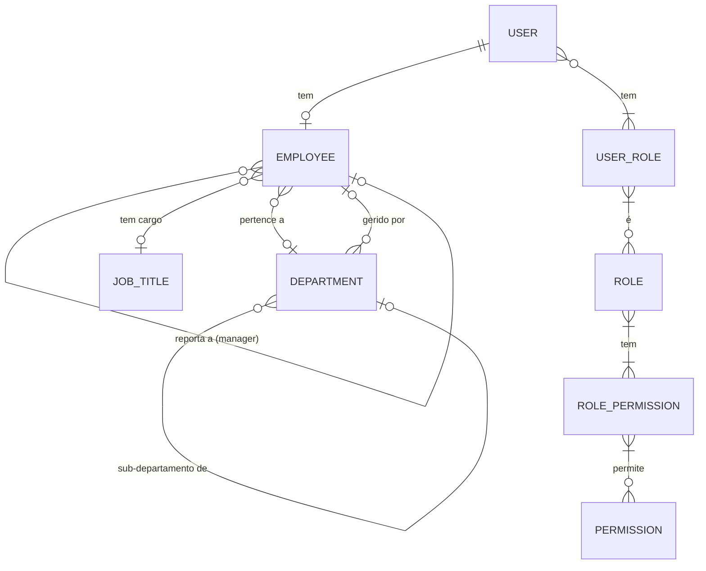

# Módulo 02 — Utilizadores & RBAC

## Objetivo

Gerir o ciclo de vida dos colaboradores no sistema, incluindo perfis, dados pessoais, hierarquia, permissões e organograma.

---

## Responsabilidades

1. Criar, editar, ativar e desativar utilizadores/colaboradores.
2. Associar utilizadores a perfis de acesso (RBAC).
3. Gerir hierarquia organizacional e responsáveis.
4. Definir cargos e funções.
5. Apresentar organograma interativo.
6. Gerir departamentos associados a utilizadores.

---

## Entidades

### Employee (Colaborador)

| Campo                 | Tipo         | Validação                  | Notas                         |
| --------------------- | ------------ | -------------------------- | ----------------------------- |
| id                    | UUID         | PK                         | —                             |
| user_id               | UUID         | FK → User, Único           | Ligação à autenticação        |
| employee_number       | VARCHAR(20)  | Único, Obrigatório         | Número interno                |
| first_name            | VARCHAR(100) | Obrigatório                | —                             |
| last_name             | VARCHAR(100) | Obrigatório                | —                             |
| email                 | VARCHAR(255) | Único, Obrigatório         | Email profissional            |
| personal_email        | VARCHAR(255) | Nullable                   | —                             |
| phone                 | VARCHAR(20)  | Nullable                   | —                             |
| nif                   | VARCHAR(20)  | Único, Nullable            | Número fiscal (GDPR sensível) |
| birth_date            | DATE         | Nullable, GDPR sensível    | —                             |
| address               | TEXT         | Nullable, GDPR sensível    | —                             |
| nationality           | VARCHAR(50)  | Nullable                   | —                             |
| gender                | VARCHAR(20)  | Nullable, GDPR sensível    | —                             |
| photo_url             | VARCHAR(512) | Nullable                   | Armazenado em MinIO           |
| department_id         | UUID         | FK → Department, Nullable  | —                             |
| job_title_id          | UUID         | FK → JobTitle, Nullable    | —                             |
| manager_id            | UUID         | FK → Employee, Nullable    | Hierarquia direta             |
| employment_start_date | DATE         | Obrigatório                | —                             |
| employment_end_date   | DATE         | Nullable                   | Data de saída                 |
| status                | ENUM         | active, inactive, on_leave | —                             |
| work_location         | VARCHAR(100) | Nullable                   | Remote, Office, Hybrid        |
| iban                  | VARCHAR(34)  | Nullable, GDPR sensível    | Para pagamentos               |
| created_at            | TIMESTAMP    | Auto                       | —                             |
| updated_at            | TIMESTAMP    | Auto                       | —                             |

### Department (Departamento)

| Campo       | Tipo         | Validação                 | Notas             |
| ----------- | ------------ | ------------------------- | ----------------- |
| id          | UUID         | PK                        | —                 |
| name        | VARCHAR(100) | Único, Obrigatório        | —                 |
| code        | VARCHAR(20)  | Único, Nullable           | Código interno    |
| parent_id   | UUID         | FK → Department, Nullable | Sub-departamentos |
| manager_id  | UUID         | FK → Employee, Nullable   | Responsável       |
| description | TEXT         | Nullable                  | —                 |
| is_active   | BOOLEAN      | Default true              | —                 |
| created_at  | TIMESTAMP    | Auto                      | —                 |

### JobTitle (Cargo/Função)

| Campo         | Tipo          | Validação                 | Notas                          |
| ------------- | ------------- | ------------------------- | ------------------------------ |
| id            | UUID          | PK                        | —                              |
| name          | VARCHAR(100)  | Único, Obrigatório        | —                              |
| level         | VARCHAR(50)   | Nullable                  | Junior, Mid, Senior, Lead      |
| department_id | UUID          | FK → Department, Nullable | —                              |
| hourly_rate   | DECIMAL(10,2) | Nullable                  | Tarifário (visível só a Admin) |
| is_active     | BOOLEAN       | Default true              | —                              |

---

## Casos de Uso

### UC-USR-001 — Criar Colaborador

**Objetivo:** Adicionar novo colaborador ao sistema.  
**Pré-condições:** Utilizador autenticado com perfil Administrador.  
**Fluxo Principal:**

1. Admin acede a "Novo Colaborador".
2. Sistema apresenta formulário com campos obrigatórios.
3. Admin preenche dados pessoais, cargo, departamento e gestor.
4. Sistema valida dados (NIF único, email único, campos obrigatórios).
5. Sistema cria registo Employee e User associado.
6. Sistema envia email de boas-vindas com link para definir password.
7. Sistema emite evento `EmployeeCreated`.
8. Sistema regista auditoria.

**Fluxos Alternativos:**

- 4a. Email já existe → erro 409, sugerir utilizador existente.
- 4b. NIF já registado → erro 409.

**Pós-condições:** Colaborador criado, User criado, email enviado.  
**Erros:** 409 Conflict, 422 Unprocessable Entity.

---

### UC-USR-002 — Editar Colaborador

**Objetivo:** Atualizar dados de um colaborador existente.  
**Pré-condições:** Utilizador autenticado; colaborador existe.  
**Fluxo Principal:**

1. Admin/Gestor acede ao perfil do colaborador.
2. Sistema apresenta dados atuais em modo edição.
3. Utilizador altera os campos pretendidos.
4. Sistema valida alterações.
5. Sistema guarda alterações e emite evento `EmployeeUpdated`.
6. Registo de auditoria com diff dos campos alterados.

**Regras:** Gestor só pode editar colaboradores da sua equipa; dados GDPR sensíveis requerem permissão explícita.

---

### UC-USR-003 — Desativar Colaborador

**Objetivo:** Encerrar acesso de um colaborador que saiu da organização.  
**Pré-condições:** Colaborador existe e está ativo.  
**Fluxo Principal:**

1. Admin seleciona colaborador e escolhe "Desativar".
2. Sistema solicita data de saída e motivo.
3. Sistema define `status = inactive` e `employment_end_date`.
4. Sistema revoga todas as sessões ativas do utilizador.
5. Sistema notifica Gestor direto.
6. Sistema emite evento `EmployeeDeactivated`.

**Fluxos Alternativos:**

- 3a. Colaborador tem timesheets pendentes de aprovação → alertar admin antes de prosseguir.
- 3b. Colaborador tem alocações ativas em projetos → alertar gestores de projeto.

---

### UC-USR-004 — Consultar Organograma

**Objetivo:** Visualizar a estrutura hierárquica da organização.  
**Pré-condições:** Utilizador autenticado.  
**Fluxo Principal:**

1. Utilizador acede a "Organograma".
2. Sistema carrega estrutura hierárquica baseada em `manager_id`.
3. Sistema apresenta árvore visual interativa.
4. Utilizador pode expandir/colapsar nós.
5. Utilizador pode clicar num colaborador para ver perfil.

**Permissões:** Todos os perfis podem ver o organograma; dados GDPR sensíveis são ocultados para colaboradores comuns.

---

### UC-USR-005 — Gerir Cargos e Funções

**Objetivo:** Criar e manter catálogo de cargos.  
**Pré-condições:** Administrador autenticado.  
**Fluxo Principal:**

1. Admin acede a "Cargos e Funções".
2. Sistema lista cargos existentes.
3. Admin cria/edita cargo com nome, nível e tarifário.
4. Sistema valida unicidade do nome.
5. Sistema guarda e emite `JobTitleUpdated`.

---

## Regras de Negócio

| ID         | Regra                                                                                       |
| ---------- | ------------------------------------------------------------------------------------------- |
| BR-USR-001 | Um colaborador não pode ser o seu próprio gestor direto.                                    |
| BR-USR-002 | Hierarquias circulares não são permitidas (A → B → A).                                      |
| BR-USR-003 | Ao desativar um colaborador, todas as suas sessões são imediatamente revogadas.             |
| BR-USR-004 | O campo NIF é sensível (GDPR) e apenas visível a Administradores.                           |
| BR-USR-005 | O campo IBAN é sensível (GDPR) e apenas visível a Administradores e RH.                     |
| BR-USR-006 | Um colaborador inativo não pode submeter timesheets, ausências ou despesas.                 |
| BR-USR-007 | O tarifário por cargo só é visível ao perfil Administrador.                                 |
| BR-USR-008 | O número de colaborador é único e não pode ser reutilizado após desativação.                |
| BR-USR-009 | Gestores só podem ver e editar colaboradores sob a sua responsabilidade direta ou indireta. |

---

## Requisitos Funcionais

| ID         | Descrição                                                                              |
| ---------- | -------------------------------------------------------------------------------------- |
| RF-USR-001 | O sistema deve permitir criar, editar, ativar e desativar colaboradores.               |
| RF-USR-002 | O sistema deve suportar associação de utilizadores a perfis (RBAC).                    |
| RF-USR-003 | O sistema deve permitir definir gestor direto para cada colaborador.                   |
| RF-USR-004 | O sistema deve apresentar organograma visual e interativo.                             |
| RF-USR-005 | O sistema deve permitir criar e gerir departamentos com hierarquia.                    |
| RF-USR-006 | O sistema deve permitir criar e gerir cargos com tarifários.                           |
| RF-USR-007 | O sistema deve suportar upload de fotografia de perfil.                                |
| RF-USR-008 | O sistema deve enviar email de boas-vindas ao criar colaborador.                       |
| RF-USR-009 | O sistema deve registar auditoria de todas as alterações a dados de colaboradores.     |
| RF-USR-010 | O sistema deve permitir pesquisa e filtragem de colaboradores por múltiplos critérios. |

---

## Permissões por Perfil

| Ação                                        | Administrador | Gestor | Aprovador | Colaborador |
| ------------------------------------------- | :-----------: | :----: | :-------: | :---------: |
| Criar colaborador                           |      ✅       |   ❌   |    ❌     |     ❌      |
| Editar qualquer colaborador                 |      ✅       |   ❌   |    ❌     |     ❌      |
| Editar colaboradores da equipa              |      ✅       |   ✅   |    ❌     |     ❌      |
| Editar próprio perfil (dados não sensíveis) |      ✅       |   ✅   |    ✅     |     ✅      |
| Ver dados GDPR sensíveis (NIF, IBAN)        |      ✅       |   ❌   |    ❌     |     ❌      |
| Desativar colaborador                       |      ✅       |   ❌   |    ❌     |     ❌      |
| Ver organograma                             |      ✅       |   ✅   |    ✅     |     ✅      |
| Gerir departamentos                         |      ✅       |   ❌   |    ❌     |     ❌      |
| Gerir cargos                                |      ✅       |   ❌   |    ❌     |     ❌      |
| Ver tarifários                              |      ✅       |   ❌   |    ❌     |     ❌      |

---

## Eventos do Sistema

| Evento                | Trigger                           |
| --------------------- | --------------------------------- |
| `EmployeeCreated`     | Criação de novo colaborador       |
| `EmployeeUpdated`     | Alteração de dados do colaborador |
| `EmployeeDeactivated` | Desativação de colaborador        |
| `EmployeeReactivated` | Reativação de colaborador         |
| `DepartmentCreated`   | Criação de departamento           |
| `DepartmentUpdated`   | Alteração de departamento         |
| `JobTitleCreated`     | Criação de cargo                  |
| `ManagerChanged`      | Alteração de gestor direto        |

---

## APIs

### GET /api/v1/employees

Listar colaboradores com filtros e paginação.

- **Query params:** `status`, `department_id`, `team_id`, `search`, `page`, `limit`
- **Saída:** `{ data: Employee[], total, page, limit }`
- **HTTP:** 200, 401, 403

### POST /api/v1/employees

Criar colaborador.

- **Entrada:** `{ first_name, last_name, email, department_id, job_title_id, manager_id, employment_start_date, ... }`
- **Saída:** `Employee`
- **HTTP:** 201, 409, 422

### GET /api/v1/employees/:id

Obter colaborador por ID.

- **HTTP:** 200, 404

### PUT /api/v1/employees/:id

Atualizar colaborador.

- **HTTP:** 200, 404, 422

### DELETE /api/v1/employees/:id

Desativar colaborador (soft delete).

- **Entrada:** `{ end_date, reason }`
- **HTTP:** 200, 404

### GET /api/v1/employees/org-chart

Obter estrutura de organograma.

- **Saída:** Árvore hierárquica de Employee
- **HTTP:** 200

### GET /api/v1/departments

### POST /api/v1/departments

### PUT /api/v1/departments/:id

### GET /api/v1/job-titles

### POST /api/v1/job-titles

### PUT /api/v1/job-titles/:id

---

## Diagrama ER (Entidades Principais)



---

## Critérios de Aceitação (Gherkin)

```gherkin
Feature: Gestão de Colaboradores

  Scenario: Criar colaborador com sucesso
    Given um utilizador com perfil Administrador autenticado
    When o admin submete dados válidos de um novo colaborador
    Then o sistema cria o colaborador com status "active"
    And envia email de boas-vindas para o email do colaborador
    And regista evento "EmployeeCreated" na auditoria

  Scenario: Impedir criação com email duplicado
    Given um colaborador existente com email "joao@empresa.pt"
    When o admin tenta criar outro colaborador com o mesmo email
    Then o sistema retorna HTTP 409
    And NÃO cria o novo colaborador

  Scenario: Desativar colaborador revoga sessões
    Given um colaborador ativo com sessão aberta
    When o admin desativa o colaborador
    Then o sistema define status como "inactive"
    And revoga imediatamente todas as sessões do colaborador
    And o colaborador não consegue fazer qualquer pedido autenticado

  Scenario: Gestor não pode ver dados GDPR sensíveis
    Given um utilizador com perfil Gestor autenticado
    When o gestor acede ao perfil de um colaborador da sua equipa
    Then o sistema mostra os dados do colaborador
    And os campos NIF e IBAN estão ocultados/mascarados
```

---

## Casos Limite

1. Colaborador é também gestor de outros — desativação deve alertar sobre dependências.
2. Departamento é eliminado com colaboradores ativos.
3. Gestor tenta aceder a colaboradores fora da sua hierarquia.
4. Dois admins editam o mesmo colaborador simultaneamente (concorrência).
5. Colaborador sem departamento associado — deve ser permitido.
6. Organograma com mais de 5 níveis hierárquicos.

---

## Notas de Implementação

**Bug corrigido em P-045 (`R-038`)**: `UsersController.update()` comparava `user.sub` (JWT, `User.id`) diretamente com o `id` (`Employee.id`) da rota `PATCH /users/:id` para decidir se era o próprio colaborador a editar o seu perfil — só coincidiam para o admin. Um colaborador real nunca conseguia editar o seu próprio perfil (403), embora Gestor/Admin sempre pudessem (comportamento existente, mantido). Corrigido injetando o novo `EmployeeIdentityService` partilhado (`backend/src/auth/services/employee-identity.service.ts`). Verificado em runtime: Bruno Costa atualizou o seu próprio `workLocation` com sucesso.

Secção de registo do estado atual da implementação do módulo no backend (`backend/src/users` e `backend/src/rbac`).

### Entregue

| Componente          | Detalhe                                                                                                                                                                                                                                                                                                                                                                                                   |
| ------------------- | --------------------------------------------------------------------------------------------------------------------------------------------------------------------------------------------------------------------------------------------------------------------------------------------------------------------------------------------------------------------------------------------------------- |
| **Entidades**       | `Employee`, `Department`, `JobTitle` (TypeORM, schema `hr`). Relações `manager/directReports`, `department`, `jobTitle`, `parent/children` e `@GdprSensitive` decorator (`nif`, `birthDate`, `address`, `gender`, `iban`).                                                                                                                                                                                |
| **Repositórios**    | `EmployeeRepository` (com `findWithHierarchy`) e `DepartmentRepository` (com `findTree`).                                                                                                                                                                                                                                                                                                                 |
| **DTOs**            | `CreateEmployeeDto`, `UpdateEmployeeDto`, `EmployeeFilterDto`, `CreateDepartmentDto`, `UpdateDepartmentDto`, `CreateJobTitleDto`, `UpdateJobTitleDto`, `OrgChartNode`.                                                                                                                                                                                                                                    |
| **UsersService**    | CRUD de colaboradores, departamentos e cargos; listagem paginada com filtros (`status`, `departmentId`, `search`); organograma hierárquico; `transferEmployee`; validação de auto-gestão e hierarquias circulares; desativação soft (`status = inactive`).                                                                                                                                                |
| **UsersController** | Endpoints sob `/users`, `/departments` e `/job-titles` com `JwtAuthGuard` + `RolesGuard` e `@Roles`.                                                                                                                                                                                                                                                                                                      |
| **RBAC decorators** | `@Roles(...RoleEnum[])` e `@Permissions(...string[])` em `backend/src/rbac/decorators`.                                                                                                                                                                                                                                                                                                                   |
| **Guards**          | `RolesGuard` (valida roles a partir de `user_roles`) e `PermissionsGuard` (valida permissões `resource:action` via `RbacService`).                                                                                                                                                                                                                                                                        |
| **RbacService**     | Atribuição/revogação de roles (`assignRole`, `revokeRole`, e as variantes por nome `assignRoleByName`/`revokeRoleByName`, P-066), listagem de permissões do utilizador (`getUserPermissions`), verificação de permissão (`hasPermission`, com bypass para `admin`) e `isAdmin(userId)` (P-046, `R-039` — usado por `Absences`/`Timesheets`/`Expenses` para substituir uma verificação de admin quebrada). |
| **Seed**            | `backend/src/database/seeds/rbac.seed.ts` cria roles (`admin`, `manager`, `approver`, `employee`), permissões CRUD por recurso e um utilizador admin padrão (`admin@hr-suite.local`).                                                                                                                                                                                                                     |

### Simplificações/Decisões

- **Criação do User associado:** o módulo recebe `userId` no DTO; não cria o registo de autenticação nem envia email de boas-vindas.
- **Auditoria e eventos:** não são emitidos eventos (`EmployeeCreated`, `EmployeeUpdated`, etc.) nem é registada auditoria de alterações.
- **Revogação de sessões:** a desativação altera o `status` e `employmentEndDate`, mas não revoga sessões ativas.
- **GDPR:** o decorador `@GdprSensitive` existe, mas não há redação/mascaramento automático dos campos sensíveis nas respostas.
- **Upload de fotografia:** `photoUrl` é apenas um campo string; não existe endpoint de upload para MinIO/S3.
- **Permissões vs Roles:** o `UsersController` usa exclusivamente `@Roles`/`RolesGuard`; `PermissionsGuard` e `@Permissions` estão implementados mas não aplicados neste módulo.
- **Gestão de perfis de acesso (P-066)**: até P-066, `RbacService.assignRole()`/`revokeRole()` existiam desde P-003 mas sem nenhum endpoint HTTP — ver secção dedicada abaixo.
- **Rotas:** os endpoints de colaboradores estão sob `/users` em vez de `/employees` (o spec original referia `/api/v1/employees`).
- **Hierarquia de departamentos:** `DepartmentRepository.findTree()` existe, mas o controller expõe apenas listagem plana (`GET /departments`).
- **Cargos:** existe `UpdateJobTitleDto` e lógica de atualização no serviço, mas não há endpoint `PATCH /job-titles/:id` no controller.
- **Transferência:** o método `UsersService.transferEmployee` existe mas não está mapeado para nenhum endpoint HTTP.
- **Número de colaborador:** a unicidade é validada; o bloqueio explícito à reutilização após desativação depende apenas da constraint única na base de dados.

### Testes

| Tipo          | Estado                                                                                                                                                                                                                                                                                                                                                                                                                                            |
| ------------- | ------------------------------------------------------------------------------------------------------------------------------------------------------------------------------------------------------------------------------------------------------------------------------------------------------------------------------------------------------------------------------------------------------------------------------------------------- |
| **Unitários** | `backend/src/users/services/users.service.spec.ts` existe e cobre `getOrganizationChart()` e `transferEmployee()` (incluindo hierarquia circular). `backend/src/rbac/services/rbac.service.spec.ts` cobre `assignRole`/`revokeRole`/`assignRoleByName`/`revokeRoleByName`/`getUserPermissions`/`isAdmin`/`hasPermission` (desde P-030, ampliado em P-066). Não existem testes unitários para o `UsersController` nem para os repositórios/guards. |
| **E2E**       | Não existem testes e2e para o módulo Users & RBAC (`backend/test/` contém apenas `auth.e2e-spec.ts` e `absences.e2e-spec.ts`).                                                                                                                                                                                                                                                                                                                    |

### Gestão de perfis de acesso — endpoints RBAC (P-066)

Descoberto ao investigar como ligar os eventos de auditoria `Users: PermissionChanged`/`Admin: RoleChanged` (`R-044`, ver `specs/audit/SPEC.md`, `specs/GLOBAL-TASKS-RISKS.md`): `RbacService.assignRole()`/`revokeRole()` existiam desde P-003, plenamente funcionais, mas sem nenhum endpoint HTTP — `RbacModule` nunca teve `controllers`. Nem `specs/users/SPEC.md` nem `specs/admin/SPEC.md` alguma vez especificaram a forma da API para isto (ao contrário do caso de `specs/expenses/SPEC.md` em P-065, que já tinha o fluxo completo documentado) — genuína ambiguidade de desenho, não um "gap de wiring" simples.

**Ambiguidade genuína encontrada e resolvida com o utilizador (decisão P066-01)**: a spec de auditoria nomeia `PermissionChanged` (módulo Utilizadores) e `RoleChanged` (módulo Admin) como dois eventos distintos, mas `RbacService` só tem uma noção de nível — atribuir/revogar um _role_ — sem qualquer conceito de permissão individual atribuível a um utilizador (as permissões são fixas por role, definidas no seed). Confirmado que os dois nomes da spec provavelmente descrevem a mesma ação de negócio vista de dois módulos diferentes. Escolhido pelo utilizador: **um único par de endpoints, cada ação decorada com um nome diferente** — `assignRole` → `@Audit('PermissionChanged', 'User')`, `revokeRole` → `@Audit('RoleChanged', 'User')` — cobrindo as duas entradas da spec sem construir nada extra (a alternativa seria implementar só um dos dois nomes e documentar o outro como sem correspondência real).

**Endpoints novos** (`UsersController`, mesmo padrão de guarda `RoleEnum.ADMIN` já usado nos outros endpoints admin-only do módulo):

- `POST /users/:employeeId/roles` (body `{ role: RoleEnum }`) → `RbacService.assignRoleByName()`.
- `DELETE /users/:employeeId/roles/:role` → `RbacService.revokeRoleByName()`.

**Detalhe técnico importante**: `RbacService.assignRole()`/`revokeRole()` operam sobre `User.id` (entidade de autenticação), não `Employee.id` — mas o padrão de rotas de `UsersController` usa sempre `Employee.id` na URL. Para evitar que o `AuditInterceptor` (`entityType: 'User'`) registasse por engano o `Employee.id` como `entity_id` (o interceptor resolve `entityId` a partir de `params.id`/`params.entityId` antes de mais nada — ver `specs/audit/SPEC.md`, P-063), o parâmetro da rota é nomeado `:employeeId` em vez de `:id`, forçando o interceptor a cair no fallback já existente (`extractIdFromResponse`, também de P-063) — ambos os endpoints devolvem `{ id: <User.id>, employeeId, role }`, de onde o interceptor extrai o `entity_id` correto.

Novos `RbacService.assignRoleByName(userId, roleName, assignedBy)`/`revokeRoleByName(userId, roleName)` resolvem o nome do perfil (`RoleEnum` string) para `Role.id` antes de delegar em `assignRole`/`revokeRole` já existentes (inalterados). Novo `AssignRoleDto` (`@IsEnum(RoleEnum)`) valida o nome do perfil no `POST`.

4 novos testes unitários em `rbac.service.spec.ts`. 419/419 testes unitários (antes 415/415). `pnpm run lint` (0 erros) e `pnpm run build` (raiz) green. Suite e2e 7/7 (51/51), sem alteração.

**Verificação em ambiente real completa**: colaborador de teste real criado; `POST /users/:employeeId/roles` com `role: manager` confirmado a criar a linha em `hr.user_roles` via `psql`; `DELETE /users/:employeeId/roles/manager` confirmado a removê-la; `POST` com um nome de perfil inválido corretamente rejeitado (400, validação do DTO, nem chega ao serviço). Confirmado via `psql` que `hr.audit_logs` regista `PermissionChanged`/`RoleChanged` com `entity_type: 'User'` e `entity_id` = o `User.id` real (não o `Employee.id` da URL) — prova de que o mecanismo de fallback funciona corretamente para este caso. Dados de teste eliminados, `hr.audit_logs` limpa no fecho da sessão.

---

## Questões em Aberto

| ID        | Questão                                                                          | Prioridade |
| --------- | -------------------------------------------------------------------------------- | ---------- |
| Q-USR-001 | Existe processo de onboarding formal que o sistema deve suportar?                | Alta       |
| Q-USR-002 | Os campos de dados pessoais são definidos por empresa (multi-tenant) ou globais? | Alta       |
| Q-USR-003 | Existe integração com Active Directory para sincronização de utilizadores?       | Alta       |
| Q-USR-004 | O organograma deve suportar múltiplas entidades legais (Bridge351 vs NIVVOS)?    | Alta       |
| Q-USR-005 | Um colaborador pode pertencer a mais do que um departamento?                     | Média      |
| Q-USR-006 | Achado Alto "`@GdprSensitive` sem interceptor de mascaramento" (`AUDIT_REPORT_2026-08-16.md`): a relação `employee` (com `nif`/`iban`/`birthDate`/`address`/`gender` em claro) é devolvida sem DTO próprio em pelo menos 10 outros módulos (Expenses, Calendar, Reports, Notifications, Absences, Training, Teams, Projects, Workflow, Timesheets), não só em `GET /users`/`GET /users/:id`. A correção deve ser um interceptor de resposta genérico aplicado a toda a app (âmbito completo, literal ao texto do achado), ou só aos 2 endpoints do módulo Users (âmbito mínimo, literal à evidência citada no relatório)? | Alta |
| Q-USR-007 | Mesmo achado — `specs/users/SPEC.md` (BR-USR-004, BR-USR-005, cenário Gherkin "Gestor não pode ver dados GDPR sensíveis") só menciona mascaramento de NIF/IBAN; a entidade `Employee` tem `@GdprSensitive` em 5 campos (acrescenta `birthDate`/`address`/`gender`). A correção deve mascarar só NIF/IBAN (literal à spec) ou os 5 campos decorados (literal ao achado)? | Alta |
| Q-USR-008 | BR-USR-005 diz que IBAN é visível a "Administradores e RH", mas o RBAC do sistema só tem 4 perfis (`admin`/`manager`/`approver`/`employee`) — não existe perfil "RH". Isto contradiz a tabela "Permissões por Perfil" da mesma spec, que só dá ✅ a Administrador para "Ver dados GDPR sensíveis (NIF, IBAN)". MANAGER deve ver o IBAN em claro (tratando "RH" como sinónimo de MANAGER) ou mascarado (literal à tabela de permissões)? | Alta |

**`Q-USR-006` a `Q-USR-008` levantadas em P-083** (sessão em que o utilizador escolheu investigar o achado Alto "Users `@GdprSensitive`" mas pediu para só documentar as ambiguidades, sem implementar — ver `AUDIT_REPORT_2026-08-16.md` e `specs/GLOBAL-TASKS-RISKS.md`). Candidato à próxima sessão.

**`Q-USR-004` parcialmente resolvida em P-069** (ao ligar `LegalEntity` ao runtime — ver `specs/admin/SPEC.md`, secção "Ligar LegalEntity ao runtime", e `specs/contracts/SPEC.md`): `Contract` passa a ter um `legalEntityId` opcional, e os campos da `LegalEntity` ligada têm efeito real em runtime (moeda de despesas via `ExpensesService`, dias de férias via `AbsencesService`). O organograma em si (`GET /users/:id/org-chart`, `getOrganizationChart()`) continua sem qualquer noção de entidade legal — fora do âmbito de P-069, que tratou só do wiring ao nível de `Contract`/Admin Settings.
