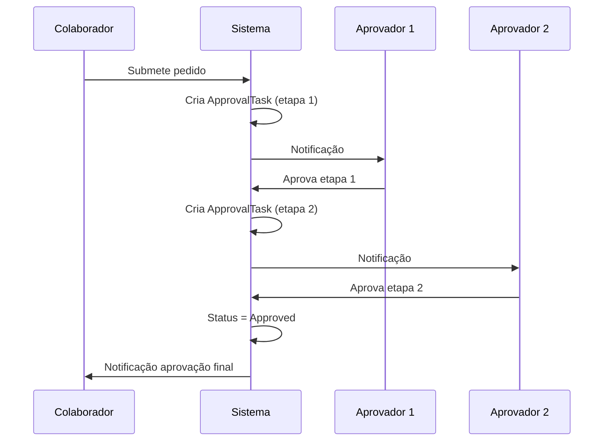

# Módulo 12 — Workflow & Caixa de Entrada

## Objetivo

Centralizar todas as tarefas de aprovação e notificações pendentes num único centro unificado, com suporte a fluxos multi-etapa, urgência e aprovação em massa.

## Entidades

### ApprovalTask

| Campo          | Tipo        | Validação                                         | Notas |
| -------------- | ----------- | ------------------------------------------------- | ----- |
| id             | UUID        | PK                                                | —     |
| task_type      | ENUM        | absence, expense, timesheet, contract, onboarding | —     |
| reference_id   | UUID        | ID da entidade                                    | —     |
| reference_type | VARCHAR(50) | Tipo da entidade                                  | —     |
| assignee_id    | UUID        | FK Employee (aprovador atual)                     | —     |
| requester_id   | UUID        | FK Employee (quem submeteu)                       | —     |
| status         | ENUM        | pending, completed, cancelled                     | —     |
| priority       | ENUM        | low, normal, high, urgent                         | —     |
| due_date       | TIMESTAMP   | Nullable                                          | —     |
| is_overdue     | BOOLEAN     | Calculado                                         | —     |
| completed_at   | TIMESTAMP   | Nullable                                          | —     |
| step_order     | INT         | Para multi-etapa                                  | —     |
| total_steps    | INT         | —                                                 | —     |
| created_at     | TIMESTAMP   | Auto                                              | —     |

### ApprovalFlow

| Campo       | Tipo         | Notas                           |
| ----------- | ------------ | ------------------------------- |
| id          | UUID         | PK                              |
| name        | VARCHAR(100) | —                               |
| entity_type | VARCHAR(50)  | absence, expense, etc.          |
| steps       | JSONB        | Array de etapas com aprovadores |
| is_active   | BOOLEAN      | —                               |

## Regras de Negócio

| ID        | Regra                                                                                 |
| --------- | ------------------------------------------------------------------------------------- |
| BR-WF-001 | Tarefas com prazo ultrapassado são marcadas automaticamente como urgentes.            |
| BR-WF-002 | Numa aprovação multi-etapa, cada etapa só fica disponível após aprovação da anterior. |
| BR-WF-003 | Aprovação em massa aplica-se apenas a tarefas do mesmo tipo.                          |
| BR-WF-004 | Ao rejeitar numa etapa intermédia, o processo termina.                                |
| BR-WF-005 | Tarefas concluídas são arquivadas após 90 dias (configurável).                        |

## Tipos de Tarefas e SLA

| Tipo                   | Origem            | SLA sugerido |
| ---------------------- | ----------------- | ------------ |
| Pedido de ausência     | Módulo Ausências  | 2 dias úteis |
| Pedido de despesa      | Módulo Despesas   | 5 dias úteis |
| Revisão de assiduidade | Módulo Timesheets | 5 dias úteis |
| Aprovação contratual   | Módulo Contratos  | 3 dias úteis |
| Onboarding             | Admin             | 1 dia útil   |

## Diagrama de Sequência — Aprovação Multi-Etapa

## Requisitos Funcionais

| ID        | Descrição                                                                   |
| --------- | --------------------------------------------------------------------------- |
| RF-WF-001 | O sistema deve centralizar todas as aprovações pendentes por utilizador.    |
| RF-WF-002 | O sistema deve suportar aprovação em massa de tarefas do mesmo tipo.        |
| RF-WF-003 | O sistema deve apresentar indicadores de urgência e prazo.                  |
| RF-WF-004 | O sistema deve suportar fluxos configuráveis multi-etapa.                   |
| RF-WF-005 | O sistema deve manter histórico de aprovações e rejeições.                  |
| RF-WF-006 | O sistema deve agrupar tarefas temporalmente (hoje, esta semana, este mês). |

## Permissões

| Ação                 | Administrador |   Gestor    | Aprovador | Colaborador |
| -------------------- | :-----------: | :---------: | :-------: | :---------: |
| Ver caixa de entrada |      ✅       |     ✅      |    ✅     |     ✅      |
| Aprovar tarefas      |      ✅       | ✅ (equipa) |    ✅     |     ❌      |
| Aprovação em massa   |      ✅       |     ✅      |    ✅     |     ❌      |
| Configurar fluxos    |      ✅       |     ❌      |    ❌     |     ❌      |

## Eventos do Sistema

| Evento          | Trigger                     |
| --------------- | --------------------------- |
| `TaskCreated`   | Nova tarefa de aprovação    |
| `TaskApproved`  | Etapa aprovada              |
| `TaskRejected`  | Etapa rejeitada             |
| `TaskOverdue`   | Prazo ultrapassado          |
| `FlowCompleted` | Fluxo multi-etapa concluído |

## APIs

- GET /api/v1/inbox
- GET /api/v1/inbox/:id
- POST /api/v1/inbox/:id/approve
- POST /api/v1/inbox/:id/reject
- POST /api/v1/inbox/bulk-approve
- GET /api/v1/approval-flows
- POST /api/v1/approval-flows
- PUT /api/v1/approval-flows/:id

## Notas de Implementação (P-015 backend, P-045 fix de auto-serviço)

Prefixo de rota real é `/api/workflow/...`, sem `/v1`. Rotas reais: `GET /workflow/inbox`, `GET /workflow/inbox/count`, `POST /workflow/inbox/:id/approve`, `POST /workflow/inbox/:id/reject`.

- **Bug corrigido em P-045 (`R-038`)**: `WorkflowController` passava `req.user.sub` (JWT, `User.id`) diretamente onde `WorkflowService` esperava um `Employee.id` — `WorkflowItem.assigneeId` tem FK para `hr.employees`, e `findInbox`, `countPending`, `approve` e `reject` filtravam/comparavam sempre pelo ID errado. Só funcionava para o admin; um gestor/aprovador real via sempre a caixa de entrada vazia. Corrigido injetando o novo `EmployeeIdentityService` partilhado (`backend/src/auth/services/employee-identity.service.ts`). Verificado em runtime: Ana Silva (gestora real) obteve corretamente a contagem de itens pendentes na sua caixa de entrada.
