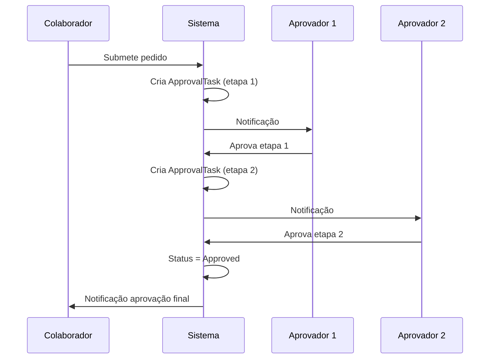

# Módulo 12 — Workflow & Caixa de Entrada

## Objetivo

Centralizar todas as tarefas de aprovação e notificações pendentes num único centro unificado, com suporte a fluxos multi-etapa, urgência e aprovação em massa.

## Entidades

### ApprovalTask

| Campo          | Tipo        | Validação                                         | Notas |
| -------------- | ----------- | ------------------------------------------------- | ----- |
| id             | UUID        | PK                                                | —     |
| task_type      | ENUM        | absence, expense, timesheet, contract, onboarding | —     |
| reference_id   | UUID        | ID da entidade                                    | —     |
| reference_type | VARCHAR(50) | Tipo da entidade                                  | —     |
| assignee_id    | UUID        | FK Employee (aprovador atual)                     | —     |
| requester_id   | UUID        | FK Employee (quem submeteu)                       | —     |
| status         | ENUM        | pending, completed, cancelled                     | —     |
| priority       | ENUM        | low, normal, high, urgent                         | —     |
| due_date       | TIMESTAMP   | Nullable                                          | —     |
| is_overdue     | BOOLEAN     | Calculado                                         | —     |
| completed_at   | TIMESTAMP   | Nullable                                          | —     |
| step_order     | INT         | Para multi-etapa                                  | —     |
| total_steps    | INT         | —                                                 | —     |
| created_at     | TIMESTAMP   | Auto                                              | —     |

### ApprovalFlow

| Campo       | Tipo         | Notas                           |
| ----------- | ------------ | ------------------------------- |
| id          | UUID         | PK                              |
| name        | VARCHAR(100) | —                               |
| entity_type | VARCHAR(50)  | absence, expense, etc.          |
| steps       | JSONB        | Array de etapas com aprovadores |
| is_active   | BOOLEAN      | —                               |

## Regras de Negócio

| ID        | Regra                                                                                 |
| --------- | ------------------------------------------------------------------------------------- |
| BR-WF-001 | Tarefas com prazo ultrapassado são marcadas automaticamente como urgentes.            |
| BR-WF-002 | Numa aprovação multi-etapa, cada etapa só fica disponível após aprovação da anterior. |
| BR-WF-003 | Aprovação em massa aplica-se apenas a tarefas do mesmo tipo.                          |
| BR-WF-004 | Ao rejeitar numa etapa intermédia, o processo termina.                                |
| BR-WF-005 | Tarefas concluídas são arquivadas após 90 dias (configurável).                        |

## Tipos de Tarefas e SLA

| Tipo                   | Origem            | SLA sugerido |
| ---------------------- | ----------------- | ------------ |
| Pedido de ausência     | Módulo Ausências  | 2 dias úteis |
| Pedido de despesa      | Módulo Despesas   | 5 dias úteis |
| Revisão de assiduidade | Módulo Timesheets | 5 dias úteis |
| Aprovação contratual   | Módulo Contratos  | 3 dias úteis |
| Onboarding             | Admin             | 1 dia útil   |

## Diagrama de Sequência — Aprovação Multi-Etapa

## Requisitos Funcionais

| ID        | Descrição                                                                   |
| --------- | --------------------------------------------------------------------------- |
| RF-WF-001 | O sistema deve centralizar todas as aprovações pendentes por utilizador.    |
| RF-WF-002 | O sistema deve suportar aprovação em massa de tarefas do mesmo tipo.        |
| RF-WF-003 | O sistema deve apresentar indicadores de urgência e prazo.                  |
| RF-WF-004 | O sistema deve suportar fluxos configuráveis multi-etapa.                   |
| RF-WF-005 | O sistema deve manter histórico de aprovações e rejeições.                  |
| RF-WF-006 | O sistema deve agrupar tarefas temporalmente (hoje, esta semana, este mês). |

## Permissões

| Ação                 | Administrador |   Gestor    | Aprovador | Colaborador |
| -------------------- | :-----------: | :---------: | :-------: | :---------: |
| Ver caixa de entrada |      ✅       |     ✅      |    ✅     |     ✅      |
| Aprovar tarefas      |      ✅       | ✅ (equipa) |    ✅     |     ❌      |
| Aprovação em massa   |      ✅       |     ✅      |    ✅     |     ❌      |
| Configurar fluxos    |      ✅       |     ❌      |    ❌     |     ❌      |

## Eventos do Sistema

| Evento          | Trigger                     |
| --------------- | --------------------------- |
| `TaskCreated`   | Nova tarefa de aprovação    |
| `TaskApproved`  | Etapa aprovada              |
| `TaskRejected`  | Etapa rejeitada             |
| `TaskOverdue`   | Prazo ultrapassado          |
| `FlowCompleted` | Fluxo multi-etapa concluído |

## APIs

- GET /api/v1/inbox
- GET /api/v1/inbox/:id
- POST /api/v1/inbox/:id/approve
- POST /api/v1/inbox/:id/reject
- POST /api/v1/inbox/bulk-approve
- GET /api/v1/approval-flows
- POST /api/v1/approval-flows
- PUT /api/v1/approval-flows/:id

## Notas de Implementação (P-015 backend, P-045 fix de auto-serviço)

Prefixo de rota real é `/api/workflow/...`, sem `/v1`. Rotas reais: `GET /workflow/inbox`, `GET /workflow/inbox/count`, `POST /workflow/inbox/:id/approve`, `POST /workflow/inbox/:id/reject`.

- **Bug corrigido em P-045 (`R-038`)**: `WorkflowController` passava `req.user.sub` (JWT, `User.id`) diretamente onde `WorkflowService` esperava um `Employee.id` — `WorkflowItem.assigneeId` tem FK para `hr.employees`, e `findInbox`, `countPending`, `approve` e `reject` filtravam/comparavam sempre pelo ID errado. Só funcionava para o admin; um gestor/aprovador real via sempre a caixa de entrada vazia. Corrigido injetando o novo `EmployeeIdentityService` partilhado (`backend/src/auth/services/employee-identity.service.ts`). Verificado em runtime: Ana Silva (gestora real) obteve corretamente a contagem de itens pendentes na sua caixa de entrada.

### P-082 — BR-WF-001 (auto-urgente) e BR-WF-003 (aprovação em massa)

Achado Alto da auditoria de 2026-08-16 ("3 de 5 regras de negócio e a entidade `ApprovalFlow` não implementadas"). Âmbito reduzido às 2 regras mais contidas (decisão P082-00) — **BR-WF-002 (multi-etapa) e a entidade `ApprovalFlow` ficam completamente por implementar**: BR-WF-002 exigiria resolver primeiro `Q-ABS-003` (`specs/absences/SPEC.md`, em aberto desde sempre) e tocar a lógica de aprovação de Absences, único módulo com o requisito RF-ABS-003/BR-ABS-008 escrito — Expenses/Timesheets não têm requisito equivalente documentado. Candidato a sessão futura maior.

- **BR-WF-001 (auto-urgente)**: `WorkflowItem` ganhou 3 colunas novas (migração `1835000000000-AddPriorityAndDueDateToWorkflowItems.ts`) — `priority` (enum `WorkflowItemPriority`: `LOW`/`NORMAL`/`HIGH`/`URGENT`, default `NORMAL`), `due_date` (nullable, sem backfill para itens já existentes) e `is_overdue` (default `false`). `due_date` é calculado (decisão P082-01) em dias úteis a partir de `requestedAt`, usando o SLA por tipo da tabela "Tipos de Tarefas e SLA" (só os 3 tipos hoje gerados — `ABSENCE`: 2, `EXPENSE`: 5, `TIMESHEET`: 5; `CONTRACT`/`ONBOARDING` continuam sem `WorkflowItem` associado, fora do âmbito) e feriado-aware via `CalendarService.findHolidays()`/`AdminService.getEffectiveCountryCode(employeeId)` (mesmo padrão de `AbsencesService.calculateBusinessDays()`, P-071) — novo `WorkflowService.calculateDueDate()`, privado. Novo `WorkflowService.markOverdueTasks()` (`@Cron('0 5 * * *')`, decisão P082-02) marca `priority=URGENT`+`isOverdue=true` para itens `PENDING` com `due_date` ultrapassado, e emite `workflow.task-overdue` (novo `WorkflowTaskOverdueEvent`, mapeia o `TaskOverdue` já nomeado na tabela "Eventos do Sistema" — sem consumidor novo, mesmo padrão de P-065).
- **BR-WF-003 (aprovação em massa)**: novo `POST /workflow/inbox/bulk-approve` (`BulkApproveDto { ids: string[], reason?: string }`, mesmos papéis de `approve`/`reject` — `ADMIN`/`MANAGER`/`APPROVER`). `WorkflowService.bulkApprove()` valida que todos os itens encontrados são do mesmo `type` (rejeita com 400 se não forem, conforme BR-WF-003) e depois aprova cada um independentemente, devolvendo um resumo por item (decisão P082-03, best-effort) — `{ id, success, error? }`; ids inexistentes entram no resumo como falha, sem abortar o lote.
- Frontend (`WorkflowInboxPage.tsx`): checkboxes por linha (desativadas para tipos diferentes do já selecionado, reforçando BR-WF-003 no cliente), botão "Aprovar selecionados (N)", banner de erro quando o resumo do bulk-approve tem falhas, e novas colunas Prazo (com indicador "(atrasado)")/Prioridade (badge `danger` para `URGENT`).
- 7 novos testes unitários (`calculateDueDate` via `handleAbsenceRequested` ×2, `bulkApprove` ×3, `markOverdueTasks` ×2). 464/464 testes unitários (antes 457/457). `pnpm run lint`/`pnpm run build` green. Suite e2e continua 7/7 (54/54), sem alteração (módulo Workflow nunca teve suite e2e própria).
- **Verificação em ambiente real completa**: migração aplicada no container real; pedido de ausência real de `sofia.almeida` (2026-08-18, terça-feira) gerou `dueDate: 2026-08-20` (2 dias úteis depois, sem feriados no intervalo) — confirmado via `GET /workflow/inbox` da manager; `bulk-approve` com tipos misturados (`ABSENCE`+`EXPENSE`) corretamente rejeitado com 400; `bulk-approve` de um item `ABSENCE` real aprovou com sucesso (confirmado o `AbsenceRequest.status` a mudar para `approved` via `psql`); `bulk-approve` de 2 `TIMESHEET` já dessincronizados de sessões de verificação anteriores devolveu corretamente `success: false` por item (prova do comportamento best-effort, sem abortar o lote); `due_date` de um item real recuado via `psql`, `markOverdueTasks()` invocado diretamente dentro do container (técnica de P-054) — confirmado `priority: URGENT`/`isOverdue: true` via `GET /workflow/inbox`. Todos os dados de teste revertidos ao estado original (aprovação de teste desfeita, item de teste eliminado) no fecho da sessão. `AUDIT_REPORT_2026-08-16.md` e `specs/GLOBAL-TASKS-RISKS.md` (decisões P082-00 a P082-03) documentam o detalhe.

### P-084 — Caixa de Entrada sem acesso ao detalhe do pedido de origem

Bug reportado diretamente pelo utilizador ao explorar a instância de demo (P-077) como `mariana.ferreira` (Manager): "A caixa de entrada exibe pedidos de Despesas, Timesheets e Ausências. Tenho as opções para Aprovar ou Rejeitar, mas não consigo aceder aos detalhes dos pedidos para análise." Investigação confirmou o gap — `WorkflowInboxPage.tsx` nunca usava `referenceId`/`referenceType` (já devolvidos por `GET /workflow/inbox`) para ligar a um ecrã de detalhe; Aprovar/Rejeitar agiam sobre a linha resumida (tipo/data/prazo/prioridade/estado), sem mostrar o conteúdo do pedido. O impacto não era uniforme: Timesheets já tinha `TimesheetDetailPage`/`/timesheets/:id`; **Ausências e Despesas não tinham nenhuma página de detalhe em todo o frontend** — nem sequer para o próprio colaborador ver os itens/recibos de um relatório de despesas já submetido.

Apresentadas 3 opções de âmbito ao utilizador (modal in-page / páginas de detalhe dedicadas / só ligar o Timesheets já existente) — **escolhida a Opção B**: construir `AbsenceDetailPage.tsx` (`/absences/:id`) e `ExpenseDetailPage.tsx` (`/expenses/:id`), ao mesmo padrão de `TimesheetDetailPage.tsx`, reaproveitando os endpoints já implementados `GET /absences/:id`/`GET /expenses/:id` (roles `ADMIN`/`MANAGER`/`APPROVER` sem scoping adicional, `EMPLOYEE` restrito ao próprio) e as ações `approve`/`reject` já existentes — sem nenhum endpoint novo no backend. `WorkflowInboxPage.tsx` ganhou um botão "Ver detalhes" por linha, que navega para `${'/timesheets'|'/absences'|'/expenses'}/${item.referenceId}` consoante `item.type`; `ExpensesListPage.tsx`/`AbsencesListPage.tsx` também passam a ligar as suas próprias linhas às novas páginas (reutilizáveis fora do contexto de aprovação, conforme a razão dada para a Opção B).

**Bug adjacente encontrado e corrigido en passant**: o enum `ExpenseReportStatus` do frontend (`frontend/src/types/expenses.ts`) tinha valores em maiúsculas (`DRAFT: 'DRAFT'`, etc.) mas o backend devolve sempre minúsculas (`'draft'`, confirmado por uma chamada real à API) — os badges de estado em `ExpensesListPage.tsx` estavam a comparar contra um valor que nunca correspondia, resultando em badges sem `label`/`variant` (`undefined`) para qualquer relatório de despesas real. Corrigido alinhando o enum ao backend e adicionando os 2 estados em falta (`SENT_FOR_PAYMENT`/`PAID`, existentes desde P-065 mas nunca refletidos no frontend); `ExpenseItem` também ganhou `isDuplicate`/`currency` (existentes no backend, em falta no tipo) e `reportId` corrigido (era `expenseReportId`, nome de campo que nunca existiu na resposta real).

Só frontend alterado — nenhum endpoint novo, nenhuma migração. `pnpm run lint` (0 erros nos ficheiros alterados) e `pnpm run build` (raiz, backend, frontend) green; 464/464 testes unitários inalterados (sem lógica de backend nova). **Verificação em ambiente real completa** (Playwright headless contra a stack Docker já em execução, dados reais de demo): login real como `mariana.ferreira` — "Ver detalhes" na Caixa de Entrada confirmado a navegar corretamente para os 3 tipos (`/expenses/:id`, `/absences/:id`, `/timesheets/:id`), cada página a mostrar o conteúdo real do pedido (itens de despesa com categoria/valor/recibo, dados da ausência com motivo/datas, grelha da folha de horas) e os botões Aprovar/Rejeitar; navegação também confirmada a partir das próprias listas de Despesas/Ausências; zero erros de consola em todos os ecrãs.
